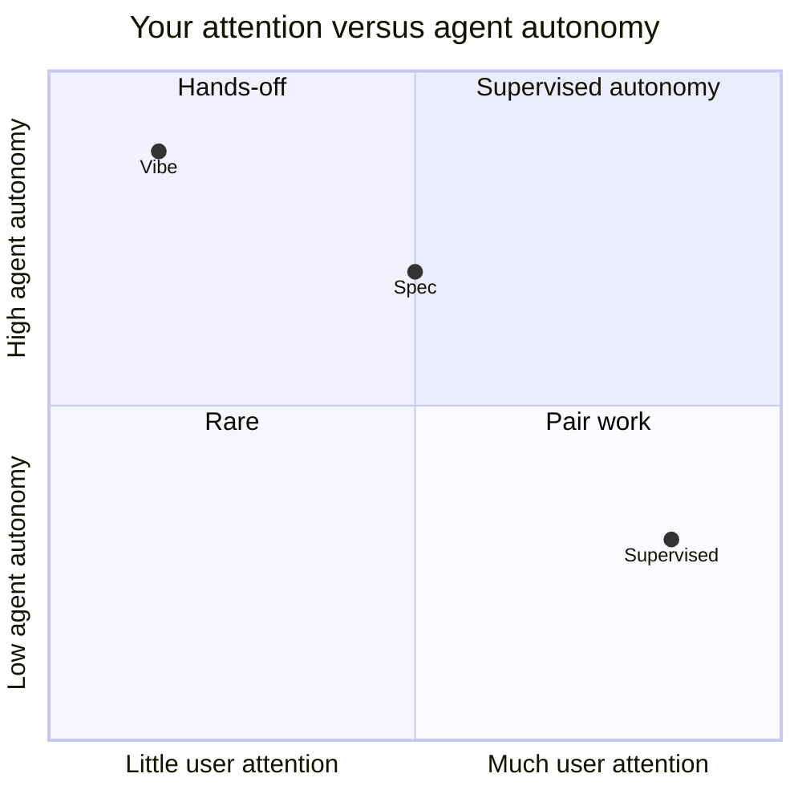
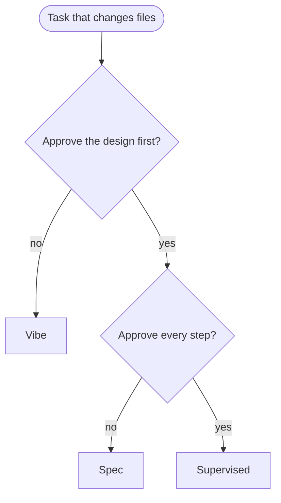
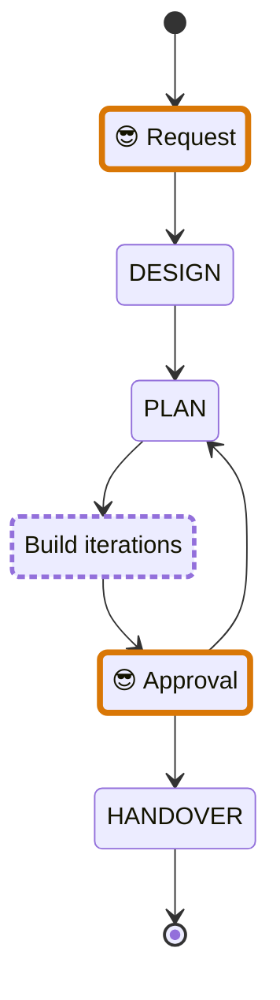
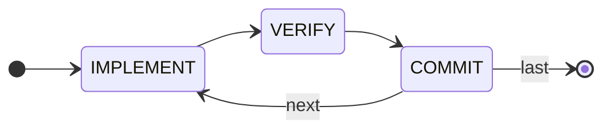

<div align="center">

# 🤖 agents

[](https://github.com/an-dr/agents/actions/workflows/checks.yml) [](LICENSE) [](https://ai-level.dev/level-3) [](https://agentskills.io/specification)

**Transparent AI development: you choose how much of your attention each change gets.**

</div>

Agent instructions, reusable skills, and a deterministic workflow controller that expose the agent's decisions, so you can understand and steer the development instead of reviewing a finished diff you never saw coming.

---

## 🎯 Why

Unseen decisions are the risk in AI development. This repository lets you choose, per task, where your attention goes: the result, the design and its documentation, or every step. Whatever you choose, the agent records requests, questions, and design choices, and it stops at gates where only your explicit approval moves the work forward. Those decisions and approvals need to survive beyond a chat session, so this repository supplies shared engineering policy and skills, with an executable controller, every flow's saved state in `tmp-agent-wip.json`, and a live progress page, `tmp-agent-progress.html`, at the host root.

## 📑 Contents

- [🤖 agents](#-agents)
    - [🎯 Why](#-why)
    - [📑 Contents](#-contents)
    - [📦 Installation](#-installation)
    - [🚀 Quickstart](#-quickstart)
        - [Pick a flow](#pick-a-flow)
    - [🧭 How the flows work](#-how-the-flows-work)
        - [One path for every flow](#one-path-for-every-flow)
        - [What each flow adds](#what-each-flow-adds)
    - [✨ Features](#-features)
    - [🔧 Configuration](#-configuration)
    - [📦 Releases](#-releases)
    - [📚 Documentation](#-documentation)
        - [📁 Repository layout](#-repository-layout)
        - [🔗 Skill dependencies](#-skill-dependencies)
    - [🧰 Development](#-development)
    - [🔍 AI disclosure](#-ai-disclosure)
    - [🤝 Contributing](#-contributing)
    - [📄 License](#-license)
    - [📈 Status](#-status)

## 📦 Installation

Install Git and Python 3 first. `main` holds the latest release; `dev` carries unreleased work. The [PowerShell setup skill](skills/actions/an-dr-env-install-powershell/SKILL.md) remains for repositories whose tools still need `pwsh`.

```sh
git clone -b main https://github.com/an-dr/agents.git
cd agents
python skills/_repository/an-dr-agents-repo-install/scripts/install-agents.py
python skills/_repository/an-dr-agents-repo-install/scripts/verify-agents.py
```

The installer adds a managed policy reference and links the skills into supported tools' user configuration. It handles Claude Code, Codex, GitHub Copilot CLI, DeepSeek Harness, Gemini CLI, and opencode; its current skill-link support covers the first four, while Gemini CLI and opencode receive policy references. See the [installation skill](skills/_repository/an-dr-agents-repo-install/SKILL.md) for tool selection, updates, conflicts, and removal.

## 🚀 Quickstart

Open the project you want to change in your AI tool and name a flow in the request:

```text
Vibe: fix the parser's handling of empty input. Preserve its public API.
```

You always name the flow yourself; the agent never infers it from task size or urgency. If you don't name one, it asks before touching a file.

### Pick a flow

The three flows trade your attention for agent autonomy. Vibe needs the least of you, Supervised the most, and Spec puts your attention on the design alone.



Two questions pick it: do you want to approve the design before any code, and if so, do you want to approve every implementation step?



| Flow       | Priority                       | You approve                                                  |
| ---------- | ------------------------------ | ------------------------------------------------------------ |
| Vibe       | the quickest loop to delivery  | the result, by running it                                    |
| Spec       | control of the system design   | the design, then the result after the review                 |
| Supervised | full understanding of the work | the scope, the design, the plan, every iteration, the result |

Work branches are pushed to the remote automatically; the base branch never is. Nothing is merged until you ask. [AGENTS.md](AGENTS.md) defines the policy, and the [workflow controller skill](skills/actions/an-dr-dev-follow-workflow/README.md) enforces its transitions.

## 🧭 How the flows work

### One path for every flow

Every flow walks the same path. The flows differ only in who does each step and where you approve.



A 😎 block with a heavy outline is yours; a dashed box opens into the diagram below it. The arrow back from Approval is more work you ask for, which goes through the plan again.

Each build iteration is one part of the plan, taken all the way to a commit:



| Step      | What always happens                                                                                                                                                                                      |
| --------- | -------------------------------------------------------------------------------------------------------------------------------------------------------------------------------------------------------- |
| Request   | You say what you want. The agent turns it into four facts: problem, constraints, definition of done, and exclusions.                                                                                     |
| Design    | The approach: options weighed, decisions taken, and a specification when the work is new.                                                                                                                |
| Plan      | The design cut into build iterations, each a part that can be documented, verified, and committed on its own.                                                                                            |
| Implement | The part's documentation first, then its code, on a work branch made from the base branch, named in the repository's own style, [Conventional Branch](https://conventionalbranch.org/) when it has none. |
| Verify    | Tests for what changed and a review of the diff, with findings fixed before anyone sees the part.                                                                                                        |
| Commit    | A commit in the repository's own message style, Conventional Commits when it has none, pushed automatically to the work branch.                                                                          |
| Approval  | You approve the result, ask for more, or drop it.                                                                                                                                                        |
| Handover  | Commits regrouped, leftovers removed, `tmp-` files stripped, and the state kept in one `DO-NOT-MERGE:` commit at the tip: a clean branch ready to integrate.                                             |

Rules that hold in every flow:

- **Iterations are checkpoints.** Each one ends committed and pushed, so a long build resumes from the last finished part, on another session or machine, and a failing check points at one part.
- **Flows don't integrate.** Handover prepares the branch to be integrated. When you ask, `an-dr-dev-integrate` lands it onto its base.
- **Work state travels with the branch.** `tmp-agent-wip.json` holds the flow, step, base branch, plan, and handoff; `tmp-agent-progress.html` shows it live.

### What each flow adds

Each flow is the common path above with these additions:

| Flow       | Additional approvals                                            | Additional rules                                                                                                                                           |
| ---------- | --------------------------------------------------------------- | ---------------------------------------------------------------------------------------------------------------------------------------------------------- |
| Vibe       | —                                                               | —                                                                                                                                                          |
| Spec       | • Design                                                        | —                                                                                                                                                          |
| Supervised | • Request scope<br>• Design<br>• Plan<br>• Each build iteration | • You explain the design; the agent polishes it<br>• Each build iteration is committed only after your approval<br>• Iterations of about 300 lines or less |

## ✨ Features

- Shared engineering instructions available across projects through one global installation.
- Three flows by attention — Vibe, Spec, Supervised — with explicit gates, resumable state, and a live progress page.
- Self-contained skills for specification, implementation, debugging, testing, review, documentation, and Git operations.
- HTML reports for code reviews, project overviews, and completed changes.
- Deterministic script checks and separate, explicitly requested agent evaluations.
- Flows that hand over a clean branch, and integration as a separate step you ask for: through pull or merge requests with the repository's merge method, or a local fallback that rebases before landing.

## 🔧 Configuration

A global installation engages the workflow policy when the host project's root `AGENTS.md` or `CLAUDE.md` references this clone, an active `tmp-agent-wip.json` exists, or the user names a flow or one of its skills. Otherwise the skills remain available on request. Add a reference to the clone's [AGENTS.md](AGENTS.md) in the host's instruction file when the project should opt in permanently.

The installer's `-Tools` parameter limits which tools are configured. Re-run the installer after adding skills or moving the clone. [Installation verification](skills/_repository/an-dr-agents-repo-verify-installation/SKILL.md) distinguishes broken links, missing project opt-in, and a running tool failing to load the policy.

Generated skill outputs live under `.tmp-ai-gen/` according to the [artifact layout convention](skills/conventions/an-dr-convention-artifact-layout/SKILL.md). HTML diagram rendering requires a local Chromium-based browser; the [HTML report convention](skills/conventions/an-dr-convention-html-report/SKILL.md) describes rendering and visual verification.

## 📦 Releases

Each release is a version in [VERSION](VERSION), with notes in [docs/releases/](docs/releases/), published on GitHub as `agents-<version>.zip`: the policy, this README, the license, and every skill except those under `skills/_repository`, which only maintain this repository. Releases are tagged `v<version>` on `main`, and pre-releases `v<version>-pre.<n>` on `dev`, published as GitHub pre-releases. Day-to-day amendments land on `dev`; `main` only receives promoted releases and hotfixes. The [release skill](skills/_repository/an-dr-agents-repo-build-release/SKILL.md) owns these branch and tag rules and builds and publishes each release.

## 📚 Documentation

- [Engineering policy](AGENTS.md): workflow selection, approvals, delivery, and Git rules.
- [Skill catalog](skills/README.md): actions, concepts, conventions, and repository maintenance skills.
- [Testing guide](tests/README.md): local checks, evaluation requests, fixtures, and coverage limits.
- [Skill testing convention](skills/conventions/an-dr-convention-agent-skill-testing/SKILL.md): the evaluation contract and execution environment.

### 📁 Repository layout

| Path                  | Purpose                                                              |
| --------------------- | -------------------------------------------------------------------- |
| `AGENTS.md`           | Policy entry point                                                   |
| `VERSION`             | The repository's version, released as `agents-<version>.zip`         |
| `docs/releases/`      | Notes for each release                                               |
| `skills/actions/`     | Procedures the agent performs                                        |
| `skills/concepts/`    | Principles applied when their subject is in play                     |
| `skills/conventions/` | Artifact formats and their mechanical checks                         |
| `skills/_repository/` | Maintenance and installation of this repository                      |
| `tests/run-all.py`    | Discovery of every skill test runner                                 |
| `.tmp-ai-gen/`        | Ignored generated skill outputs, with a `<kind>-latest` copy of each |

### 🔗 Skill dependencies

Skills declare the other skills they name through `metadata.an-dr.dependencies`. The [skill convention](skills/conventions/an-dr-convention-agent-skill/SKILL.md) defines this contract and the portability rules: each skill owns its files, and callers pass the location of another skill's public script rather than assuming an installation layout.

The [dependency builder](skills/_repository/an-dr-agents-repo-build-dependencies/SKILL.md) derives the graph below from those declarations. Arrows point from a skill to its declared dependencies. Isolated skills are omitted; the graph describes instruction dependencies, rather than every runtime script call.

```mermaid
flowchart LR
    %% diagram-budget: exempt generated reference graph of every skill
    subgraph g_repository["Repository"]
        an-dr-agents-analyze-session
        an-dr-agents-repo-build-dependencies
        an-dr-agents-repo-build-release
        an-dr-agents-repo-convention-skills
        an-dr-agents-repo-install
        an-dr-agents-repo-modify
        an-dr-agents-repo-verify-installation
    end
    subgraph g_actions["Actions"]
        an-dr-ai-collect-input
        an-dr-ai-review-instruction
        an-dr-ai-skill-implement-test
        an-dr-ai-skill-test
        an-dr-ai-use-user-interface
        an-dr-ai-use-wip-data
        an-dr-ai-write-instruction
        an-dr-architecture-fix-dependencies
        an-dr-dev-analyze-changes
        an-dr-dev-analyze-slop
        an-dr-dev-assign-ai-level
        an-dr-dev-debug
        an-dr-dev-design
        an-dr-dev-follow-workflow
        an-dr-dev-implement-adversarial-ut
        an-dr-dev-implement-code
        an-dr-dev-implement-pipeline
        an-dr-dev-integrate
        an-dr-dev-review
        an-dr-dev-test
        an-dr-dev-write-documentation
        an-dr-dev-write-readme
        an-dr-dev-write-specification
        an-dr-env-install-powershell
        an-dr-files-build-report
        an-dr-files-make-screengif
        an-dr-files-make-screenshot
        an-dr-git-modify-history
        an-dr-project-write-overview
        an-dr-text-analyze-slop
        an-dr-text-verify-claims
        an-dr-text-write-curated
    end
    subgraph g_concepts["Concepts"]
        an-dr-concept-ai-slop
        an-dr-concept-clean-dependencies
        an-dr-concept-dark-cockpit
        an-dr-concept-evidence-grounding
        an-dr-concept-single-authority
    end
    subgraph g_conventions["Conventions"]
        an-dr-convention-adr
        an-dr-convention-agent-skill
        an-dr-convention-agent-skill-testing
        an-dr-convention-ai-level
        an-dr-convention-artifact-layout
        an-dr-convention-branch-name
        an-dr-convention-code
        an-dr-convention-commit-message
        an-dr-convention-diagram
        an-dr-convention-html-repo-style
        an-dr-convention-html-report
        an-dr-convention-layout
        an-dr-convention-markdown
        an-dr-convention-readme
        an-dr-convention-script
        an-dr-convention-use-case
    end
    an-dr-agents-analyze-session --> an-dr-agents-repo-modify
    an-dr-agents-repo-build-dependencies --> an-dr-ai-use-user-interface & an-dr-convention-agent-skill
    an-dr-agents-repo-build-release --> an-dr-ai-use-user-interface & an-dr-git-modify-history
    an-dr-agents-repo-convention-skills --> an-dr-ai-skill-implement-test & an-dr-ai-skill-test & an-dr-convention-agent-skill & an-dr-dev-test & an-dr-dev-write-documentation & an-dr-convention-agent-skill-testing
    an-dr-agents-repo-install --> an-dr-ai-skill-test
    an-dr-agents-repo-modify --> an-dr-agents-repo-build-release & an-dr-agents-repo-convention-skills & an-dr-agents-repo-install & an-dr-agents-repo-verify-installation & an-dr-ai-review-instruction & an-dr-ai-use-user-interface & an-dr-ai-skill-implement-test & an-dr-ai-skill-test & an-dr-ai-write-instruction & an-dr-convention-agent-skill & an-dr-convention-markdown & an-dr-convention-script & an-dr-git-modify-history
    an-dr-agents-repo-verify-installation --> an-dr-agents-repo-build-release & an-dr-agents-repo-install & an-dr-ai-skill-implement-test & an-dr-ai-skill-test & an-dr-ai-use-wip-data & an-dr-convention-commit-message
    an-dr-ai-collect-input --> an-dr-ai-use-user-interface & an-dr-concept-ai-slop & an-dr-concept-evidence-grounding
    an-dr-ai-review-instruction --> an-dr-ai-use-user-interface
    an-dr-ai-skill-implement-test --> an-dr-ai-write-instruction & an-dr-convention-agent-skill & an-dr-convention-script & an-dr-convention-agent-skill-testing
    an-dr-ai-skill-test --> an-dr-ai-skill-implement-test & an-dr-ai-use-user-interface & an-dr-files-build-report & an-dr-convention-script & an-dr-convention-agent-skill-testing
    an-dr-ai-use-user-interface --> an-dr-concept-dark-cockpit & an-dr-convention-html-repo-style & an-dr-files-build-report
    an-dr-ai-write-instruction --> an-dr-ai-review-instruction & an-dr-concept-ai-slop & an-dr-convention-markdown & an-dr-dev-write-documentation
    an-dr-architecture-fix-dependencies --> an-dr-ai-use-user-interface & an-dr-concept-clean-dependencies & an-dr-files-build-report & an-dr-convention-html-report
    an-dr-dev-analyze-changes --> an-dr-concept-ai-slop & an-dr-convention-diagram & an-dr-files-build-report & an-dr-convention-html-report & an-dr-dev-write-documentation
    an-dr-dev-analyze-slop --> an-dr-ai-review-instruction & an-dr-ai-use-user-interface & an-dr-concept-ai-slop & an-dr-files-build-report & an-dr-convention-html-report
    an-dr-dev-assign-ai-level --> an-dr-ai-use-user-interface & an-dr-convention-ai-level
    an-dr-dev-design --> an-dr-ai-use-user-interface & an-dr-convention-adr & an-dr-convention-use-case & an-dr-dev-write-documentation
    an-dr-dev-follow-workflow --> an-dr-ai-use-user-interface & an-dr-ai-use-wip-data & an-dr-convention-adr & an-dr-convention-branch-name & an-dr-dev-analyze-changes & an-dr-dev-debug & an-dr-dev-design & an-dr-dev-implement-code & an-dr-dev-implement-pipeline & an-dr-dev-integrate & an-dr-dev-review & an-dr-dev-test & an-dr-dev-write-documentation & an-dr-dev-write-readme & an-dr-dev-write-specification & an-dr-git-modify-history
    an-dr-dev-implement-code --> an-dr-convention-adr & an-dr-convention-code & an-dr-convention-layout & an-dr-dev-write-documentation & an-dr-git-modify-history
    an-dr-dev-implement-pipeline --> an-dr-ai-use-user-interface & an-dr-convention-code
    an-dr-dev-integrate --> an-dr-ai-use-user-interface & an-dr-ai-use-wip-data & an-dr-convention-commit-message & an-dr-git-modify-history
    an-dr-dev-review --> an-dr-ai-use-user-interface & an-dr-concept-ai-slop & an-dr-concept-clean-dependencies & an-dr-concept-evidence-grounding & an-dr-convention-artifact-layout & an-dr-convention-code & an-dr-convention-html-repo-style & an-dr-convention-html-report & an-dr-convention-layout
    an-dr-dev-test --> an-dr-ai-use-user-interface & an-dr-dev-implement-adversarial-ut
    an-dr-dev-write-documentation --> an-dr-ai-use-user-interface & an-dr-concept-ai-slop & an-dr-convention-adr & an-dr-convention-diagram & an-dr-convention-markdown & an-dr-convention-use-case
    an-dr-dev-write-readme --> an-dr-ai-use-user-interface & an-dr-dev-assign-ai-level & an-dr-convention-markdown & an-dr-convention-readme & an-dr-dev-write-documentation & an-dr-files-make-screengif & an-dr-files-make-screenshot
    an-dr-dev-write-specification --> an-dr-ai-use-user-interface & an-dr-concept-clean-dependencies & an-dr-convention-adr & an-dr-convention-use-case & an-dr-dev-write-documentation
    an-dr-env-install-powershell --> an-dr-ai-use-user-interface
    an-dr-files-build-report --> an-dr-convention-artifact-layout & an-dr-convention-html-repo-style & an-dr-convention-html-report
    an-dr-files-make-screengif --> an-dr-files-make-screenshot
    an-dr-files-make-screenshot --> an-dr-files-build-report
    an-dr-git-modify-history --> an-dr-convention-commit-message
    an-dr-project-write-overview --> an-dr-concept-ai-slop & an-dr-files-build-report & an-dr-convention-html-report & an-dr-dev-write-documentation
    an-dr-text-analyze-slop --> an-dr-ai-use-user-interface & an-dr-concept-ai-slop & an-dr-files-build-report & an-dr-convention-html-report
    an-dr-text-verify-claims --> an-dr-ai-use-user-interface & an-dr-files-build-report & an-dr-convention-html-report
    an-dr-text-write-curated --> an-dr-ai-use-user-interface & an-dr-text-verify-claims & an-dr-text-analyze-slop & an-dr-convention-artifact-layout
    an-dr-convention-agent-skill --> an-dr-concept-clean-dependencies & an-dr-convention-script & an-dr-convention-agent-skill-testing & an-dr-convention-markdown
    an-dr-convention-code --> an-dr-concept-ai-slop & an-dr-concept-clean-dependencies & an-dr-convention-layout
    an-dr-convention-html-report --> an-dr-concept-dark-cockpit & an-dr-convention-artifact-layout & an-dr-convention-diagram & an-dr-convention-html-repo-style
    an-dr-convention-layout --> an-dr-convention-artifact-layout
    an-dr-convention-readme --> an-dr-concept-ai-slop & an-dr-concept-evidence-grounding & an-dr-convention-markdown
    an-dr-convention-script --> an-dr-ai-use-user-interface & an-dr-convention-agent-skill-testing
```

<details><summary>Show the generated dependency graph</summary>

<!-- skill-dependencies begin -->



<!-- skill-dependencies end -->

</details>

## 🧰 Development

Run the repository checks from the clone root:

```sh
python tests/run-all.py
```

The runner discovers skill manifests and invokes each `scripts/tests/run.py`. By default it runs suites affected by uncommitted changes; `python tests/run-all.py --all` runs every suite, as CI does. Each suite owns its validators and regression tests; the testing convention's suite discovers `evals/evals.json` files and validates their ZIP fixtures. Missing runners and failed suites produce a nonzero exit code. Fixture scripts are excluded from test discovery.

Skills with scripts keep deterministic tests in `scripts/tests/`. Every skill has behavioral cases in `evals/evals.json` and evaluation intent in `evals/EVAL.md`; repository fixtures, when needed, are ZIP archives under `evals/fixtures/`. See the [testing guide](tests/README.md) for commands and run limits. Syntax-only checks establish parsing coverage, and successful structural checks do not establish that an agent follows a skill.

[GitHub Actions](.github/workflows/checks.yml) runs free checks on pushes and pull requests. CI installs the Agent Skills reference validator, `skills-ref`; local checks report its installation command when it is missing. Agent evaluations consume model usage and run only on explicit request, with declared environments and bounded attempts.

## 🔍 AI disclosure

This repository values transparency about how software is made, and it encourages everyone to disclose AI usage in their repositories. Its own level is 3 (`ASSISTED`) on the [ai-level.dev](https://ai-level.dev) scale: AI wrote functional modules, and a human reviews every change before it enters history. The [AI level convention](skills/conventions/an-dr-convention-ai-level/SKILL.md) defines the levels, and the [assign skill](skills/actions/an-dr-dev-assign-ai-level/SKILL.md) assigns one to any repository, offered whenever a README is written.

## 🤝 Contributing

See [CONTRIBUTING.md](CONTRIBUTING.md): pull requests target `dev`, and the repository checks must pass.

## 📄 License

[MIT](LICENSE), copyright 2026 Andrei Gramakov.

## 📈 Status

Actively maintained, with automated checks on pushes and pull requests. CI checks scripts and packaging; behavioral reliability requires separately executed agent evaluations.
