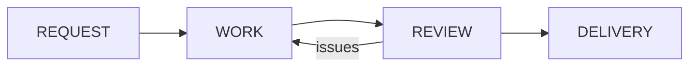
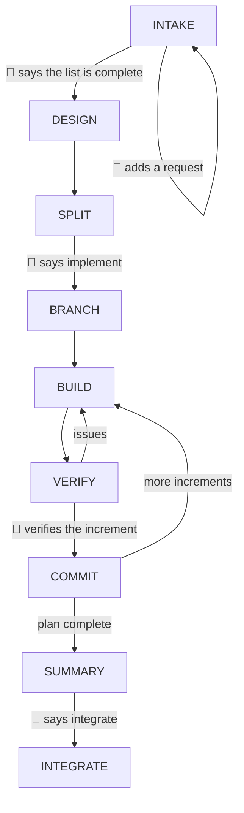
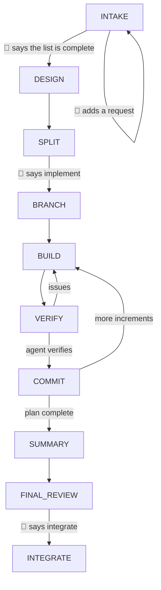
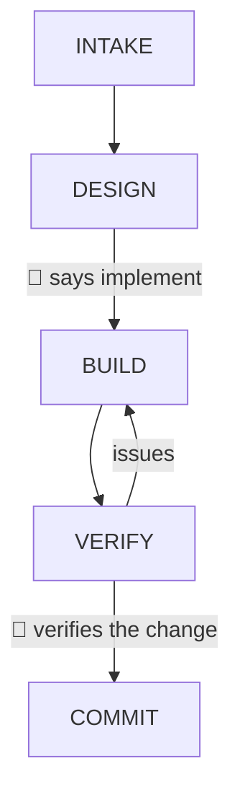
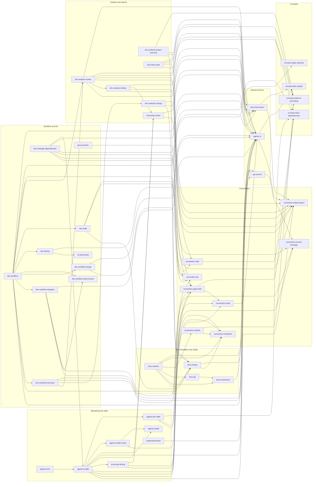

# agents

An executable AI development workflow focused on reliable engineering rather than conversational memory.

`AGENTS.md` defines policy. Before changing files, the agent asks the user to select Direct, Quick, Detailed, or Detailed Auto unless the user already selected a workflow or one is active. Direct completes and delivers the request without approval gates or workflow state. `skills/dev-workflow/scripts/workflow.ps1` enforces the gated flows' phase transitions and stores committable state in `.progress/workflow.json`. Before integration, `dev-workflow-clean-branch` removes that state from every feature-branch commit.

In the gated-flow diagrams below, 👤 marks a transition the user's own words drive. Every other edge is the agent's to take.

## Direct

When the user selects Direct, the agent works on the current branch, chooses a sound approach, updates needed documentation, implements, reviews, runs relevant checks, fixes findings, and delivers the result in the same request. It creates no `.progress/` state and asks no further workflow approvals. Verified work is committed locally; pushing still requires the user's request. Changes to this process repository remain uncommitted for the user's review under its own scope rule.



## Detailed

For multi-increment, architectural, or public-interface work. INTAKE, DESIGN, and SPLIT only read and ask; they accumulate what the user wants as requests and what the user must decide as questions, and change nothing. Three commands drive the flow — **intake** closes the request list, **implement** releases the plan into code, **integrate** lands the reviewed branch — and between them the user still verifies each increment.



The controller refuses the implement approval while any question is still open, so nothing is built on an unanswered assumption.

## Detailed Auto

Runs the same phases, reviews, tests, commits, and integration preparation as Detailed, and keeps the same three commands. What it automates is the middle: the agent verifies and commits each increment itself, so the user closes intake, approves the plan, and is not asked again until the final review.



## Quick

For one small, self-contained change with a handful of clear design choices. It uses one build/verify/commit pass on the current branch, behind the same implement command.



## Integration

`INTEGRATE` always rebases, so the default branch never gains a merge commit. 👤 The user then chooses how the branch lands, and the skill asks every time:

| Mode | Result |
| --- | --- |
| Commits | every commit is kept and the base fast-forwards |
| Regroup | the branch is rebuilt as a few logical commits and the base fast-forwards |
| Squash | the branch becomes one commit and the base fast-forwards |
| Request | the branch becomes one commit, is pushed, and a pull request is opened |
| RebaseMerge | the branch is regrouped, pushed as a pull request, and landed by the platform's rebase and merge once CI passes |

Future Detailed increments can be inserted or reordered without changing active or completed increment identity. The controller validates approvals, branches, commits, and legal transitions before saving state atomically. Every controller change prints user-presentable Markdown tables for the workflow phases and increment statuses.

## Repository layout

- `AGENTS.md` — concise policy and entry point, including the skill table every tool reads
- `skills/` — one self-contained folder per skill; `skills/README.md` lists them with the same one-line uses as `AGENTS.md`
- `skills/dev-workflow/` — executable workflow state machine
- `skills/git-commit/` — the commit message format and its checker. Commits are attributed to the person who records them; the checker rejects AI co-author and generator trailers
- `skills/agents-install/` — global installation for local AI tools
- `skills/agents-modify/` — changing this repository's own instructions from a host project, and the registration check
- `skills/install-powershell/` — PowerShell 7 bootstrap instructions
- `tests/run-all.ps1` — runs every skill test and repository check; CI runs it on each push
- `.artifacts/ai-<YYYY-MM-DD>-<N>/` — ignored per-run directory holding that run's review JSON, rendered HTML, and reports; `skills/convention-artifact-layout/` owns the layout

## Development analysis

The analysis skills cover distinct tasks: `dev-analysis-deslop` inspects selected changes, a branch diff, files, directories, or a whole repository for illogical or questionable code and documentation artifacts and proposes changes in a prioritized HTML findings table; `dev-analysis-review` reviews a diff and includes a deslop pass over the same scope; `dev-analysis-change` explains a delivered change in HTML; and `dev-workflow-summary` prepares the full-branch integration handoff.

## Skills stay portable

Each skill runs from its own folder, so it works whether it is installed with the rest of this repository, on its own, or through another tool. No code is shared through a folder outside `skills/<name>/`. When one skill's script needs another skill, it calls that skill's public script, and the agent passes the other skill's folder as a parameter, for example `-ConventionCommitMessageSkill <convention-commit-message>`. The script never guesses where the other skill is installed. Small generic helpers are copied into each skill that needs them. `skills/convention-agent-skill/` states the rules, and its `check-registration.ps1` enforces them.

## Skill dependencies

This diagram is generated from the `metadata.dependencies` each skill declares in its [instructions](skills/README.md). A skill declares every skill it names, and `check-registration.ps1` fails on a skill that names an undeclared one, declares one it never names, or sits on a dependency cycle. `PROHIBITED` marks a stable skill, such as a concept, that must name no other skill.

Arrows point from a skill to a skill it names. Groups organise the view by current role, not installation boundaries. Skills that name no skill and are named by none are omitted, and transitive dependencies are reached by following arrows.



Script inspection reveals dependencies the instructions do not name: `agents-modify` loads `agents-install`'s module to locate the clone, and `agents-health-check` runs its verifier unless the install check is skipped.

The [PowerShell bootstrap skill](skills/install-powershell/SKILL.md) applies before running skill scripts when PowerShell 7 is unavailable.

## Checks

```powershell
pwsh tests/run-all.ps1
```

It prints one table of results and exits non-zero when any step fails.
