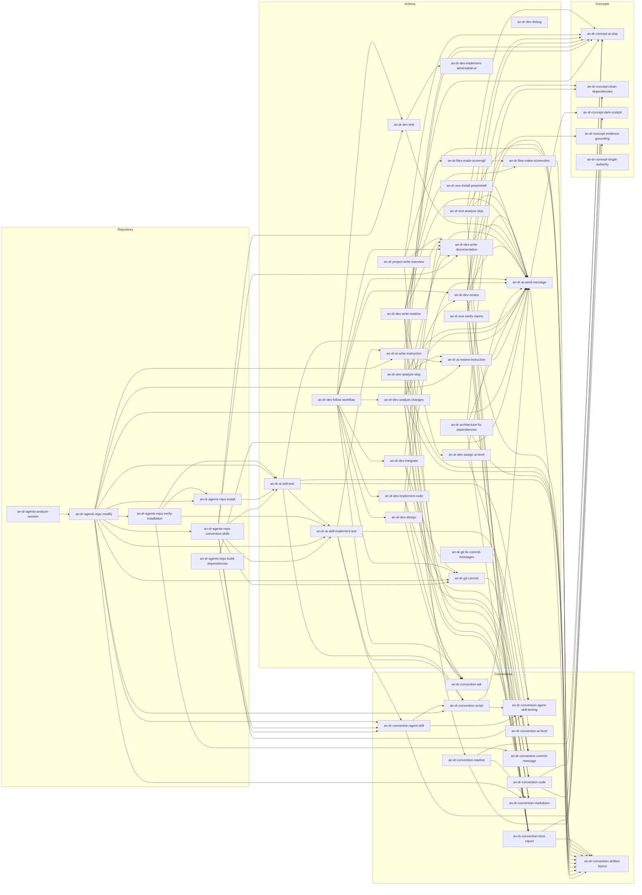

# 🤖 agents

[](https://github.com/an-dr/agents/actions/workflows/checks.yml) [](LICENSE) [](https://ai-level.dev/level-3) [](https://agentskills.io/specification) [](#-installation)

**Transparent, human-controlled AI development. Not vibe coding.**

Agent instructions, reusable skills, and a deterministic workflow controller that expose the agent's decisions, so you can understand and steer the development instead of reviewing a finished diff you never saw coming.

## 🎯 Why

Vibe coding hides the decisions. This repository makes them visible and puts you in charge of them: the agent records requests, questions, and design choices, and it stops at gates where only your explicit approval moves the work forward (intake, implement, integrate). Those decisions and approvals need to survive beyond a chat session, so this repository supplies shared engineering policy and skills, with an executable controller for gated work and saved state in `.progress/workflow.json`. Direct work uses the same engineering guidance without controller state or approval gates.

## 📑 Contents

- [📦 Installation](#-installation)
- [🚀 Quickstart](#-quickstart)
- [✨ Features](#-features)
- [🔧 Configuration](#-configuration)
- [📚 Documentation](#-documentation)
- [🧰 Development](#-development)
- [🔍 AI disclosure](#-ai-disclosure)
- [🤝 Contributing](#-contributing)
- [📄 License](#-license)
- [📈 Status](#-status)

## 📦 Installation

Install Git and PowerShell 7 first. The [PowerShell setup skill](skills/actions/an-dr-env-install-powershell/SKILL.md) covers a missing or outdated `pwsh` runtime.

```powershell
git clone https://github.com/an-dr/agents.git
Set-Location agents
pwsh skills/_repository/an-dr-agents-repo-install/scripts/install-agents.ps1
pwsh skills/_repository/an-dr-agents-repo-install/scripts/verify-agents.ps1
```

The installer adds a managed policy reference and links the skills into supported tools' user configuration. It handles Claude Code, Codex, GitHub Copilot CLI, Gemini CLI, and opencode; its current skill-link support covers the first three, while Gemini CLI and opencode receive policy references. See the [installation skill](skills/_repository/an-dr-agents-repo-install/SKILL.md) for tool selection, updates, conflicts, and removal.

## 🚀 Quickstart

Open the project you want to change in your AI tool and select a flow in the request:

```text
Use Direct to fix the parser's handling of empty input. Preserve its public
API and run the existing tests before committing the change. Do not push.
```

| Flow | Use it for | User decisions |
| --- | --- | --- |
| Direct | Work completed on the current branch | No workflow approval gates |
| Quick | One self-contained pass on the current branch | Implementation and verification |
| Detailed | Planned increments on a feature branch | Intake, implementation, each increment's verification, and integration |
| Detailed Auto | Planned increments with agent verification | Intake, implementation, and final integration |

For gated work, the [workflow controller skill](skills/actions/an-dr-dev-follow-workflow/SKILL.md) owns the commands and transitions. The agent resumes existing state instead of reconstructing it from conversation history. [AGENTS.md](AGENTS.md) defines the policy, including the separate review rule for changes to this process repository.

## ✨ Features

- Shared engineering instructions available across projects through one global installation.
- Explicit workflow gates and resumable state for Quick, Detailed, and Detailed Auto.
- Self-contained skills for implementation, debugging, testing, review, documentation, and Git operations.
- HTML reports for code reviews, project overviews, and completed changes.
- Deterministic script checks and separate, explicitly requested agent evaluations.
- Integration choices that rebase before landing and remove workflow state from delivered history.

## 🔧 Configuration

A global installation engages the workflow policy when the host project's root `AGENTS.md` or `CLAUDE.md` references this clone, an active `.progress/workflow.json` exists, or the user names a flow or one of its skills. Otherwise the skills remain available on request. Add a reference to the clone's [AGENTS.md](AGENTS.md) in the host's instruction file when the project should opt in permanently.

The installer's `-Tools` parameter limits which tools are configured. Re-run the installer after adding skills or moving the clone. [Installation verification](skills/_repository/an-dr-agents-repo-verify-installation/SKILL.md) distinguishes broken links, missing project opt-in, and a running tool failing to load the policy.

Generated reports and scratch output live under `.artifacts/` according to the [artifact layout convention](skills/conventions/an-dr-convention-artifact-layout/SKILL.md). HTML diagram rendering requires a local Chromium-based browser; the [HTML report convention](skills/conventions/an-dr-convention-html-report/SKILL.md) describes rendering and visual verification.

## 📚 Documentation

- [Engineering policy](AGENTS.md): workflow selection, approvals, delivery, and Git rules.
- [Skill catalog](skills/README.md): actions, concepts, conventions, and repository maintenance skills.
- [Testing guide](tests/README.md): local checks, evaluation requests, fixtures, and coverage limits.
- [Skill testing convention](skills/conventions/an-dr-convention-agent-skill-testing/SKILL.md): the evaluation contract and execution environment.
- Decisions: this repository keeps no ADRs. Every decision is stated in the skill or policy that owns it, so the skills and [AGENTS.md](AGENTS.md) are the record.

### 📁 Repository layout

| Path | Purpose |
| --- | --- |
| `AGENTS.md` | Policy entry point |
| `skills/actions/` | Procedures the agent performs |
| `skills/concepts/` | Principles applied when their subject is in play |
| `skills/conventions/` | Artifact formats and their mechanical checks |
| `skills/_repository/` | Maintenance and installation of this repository |
| `tests/run-all.ps1` | Discovery of conventional skill test runners |
| `.artifacts/` | Ignored generated reports and scratch output |

### 🔗 Skill dependencies

Skills declare the other skills they name through `metadata.an-dr.dependencies`. The [skill convention](skills/conventions/an-dr-convention-agent-skill/SKILL.md) defines this contract and the portability rules: each skill owns its files, and callers pass the location of another skill's public script rather than assuming an installation layout.

The [dependency builder](skills/_repository/an-dr-agents-repo-build-dependencies/SKILL.md) derives the graph below from those declarations. Arrows point from a skill to its declared dependencies. Isolated skills are omitted; the graph describes instruction dependencies, rather than every runtime script call.

<details><summary>Show the generated dependency graph</summary>

<!-- skill-dependencies begin -->



<!-- skill-dependencies end -->

</details>

## 🧰 Development

Run the repository checks from the clone root:

```powershell
pwsh tests/run-all.ps1
```

The runner discovers skill manifests and invokes each conventional `scripts/tests/run.ps1`. Each suite owns its validators and regression tests; the testing convention's suite discovers `evals/evals.json` files and validates their ZIP fixtures. Missing runners and failed suites produce a nonzero exit code. Fixture scripts are excluded from test discovery.

Skills with scripts keep deterministic tests in `scripts/tests/`. Every skill has behavioral cases in `evals/evals.json` and evaluation intent in `evals/EVAL.md`; repository fixtures, when needed, are ZIP archives under `evals/fixtures/`. See the [testing guide](tests/README.md) for commands and run limits. Syntax-only checks establish parsing coverage, and successful structural checks do not establish that an agent follows a skill.

[GitHub Actions](.github/workflows/checks.yml) runs free checks on pushes and pull requests. CI installs the Agent Skills reference validator, `skills-ref`; local checks report its installation command when it is missing. Agent evaluations consume model usage and run only on explicit request, with declared environments and bounded attempts.

## 🔍 AI disclosure

This repository values transparency about how software is made, and it encourages everyone to disclose AI usage in their repositories. Its own level is 3 (`ASSISTED`) on the [ai-level.dev](https://ai-level.dev) scale: AI wrote functional modules, and a human reviews every change before it enters history. The [AI level convention](skills/conventions/an-dr-convention-ai-level/SKILL.md) defines the levels, and the [assign skill](skills/actions/an-dr-dev-assign-ai-level/SKILL.md) assigns one to any repository, offered whenever a README is written.

## 🤝 Contributing

Follow [AGENTS.md](AGENTS.md) for changes to this repository, use the [skill convention](skills/conventions/an-dr-convention-agent-skill/SKILL.md) when changing skills, and run the repository checks before proposing a change. Keep generated artifacts out of commits.

## 📄 License

[MIT](LICENSE), copyright 2026 Andrei Gramakov.

## 📈 Status

Actively maintained, with automated checks on pushes and pull requests. CI checks scripts and packaging; behavioral reliability requires separately executed agent evaluations.
