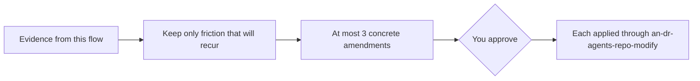

# an-dr-agents-analyze-session

A retrospective on the process itself: it finds where the workflow caused friction in a finished flow and proposes at most three amendments to `AGENTS.md` or a skill for your approval.

## When it runs

After a Spec-driven or Supervised flow is integrated, or when you ask for a retrospective.

## How it works

Evidence includes phases that stalled or looped, rules violated or clarified mid-flow, questions you answered twice, increments that broke the size rule, and verification findings that an earlier design or review would have caught. A one-off mistake is not process feedback, and code findings are out of scope.

Each proposal is an exact wording change, names the friction it removes and the evidence behind it, and prefers deleting or simplifying a rule over adding one. The retrospective itself edits nothing.

## What you get

Up to three evidence-backed amendments, presented as choices.

## What you decide

Which amendments to apply.

## Related skills

- [an-dr-agents-repo-modify](../an-dr-agents-repo-modify/README.md) — applies them.
