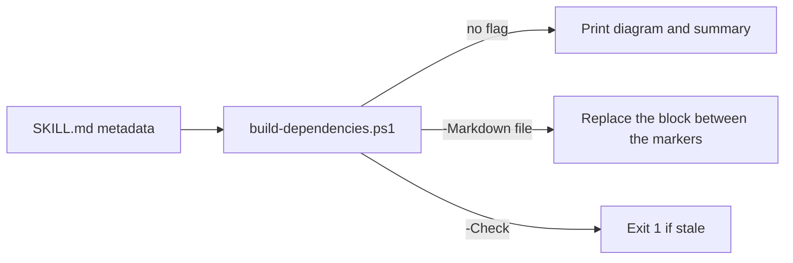

# an-dr-agents-repo-build-dependencies

Builds a Mermaid dependency graph of the repository's skills from their declared `an-dr.dependencies` and keeps the diagram block in a Markdown file current.

## When it runs

After a skill is added, renamed, or re-declares its dependencies, or when the diagram needs refreshing. The repository tests fail while the block is stale.

## How it works

- Each category folder is a group; each declared name is an arrow.
- A skill with no declaration is drawn dashed and listed, since missing differs from declaring none; a declared name matching no skill is listed too.
- The generated block is never edited by hand. Whether a declaration matches what a skill actually names is the registration check's job.

## What you get

A current skill graph in `README.md`, plus counts of skills and arrows and a list of anything marked.

## Related skills

- [an-dr-convention-agent-skill](../../conventions/an-dr-convention-agent-skill/README.md) — the declaration format.
- [an-dr-architecture-fix-dependencies](../../actions/an-dr-architecture-fix-dependencies/README.md) — fixes what the graph shows.
