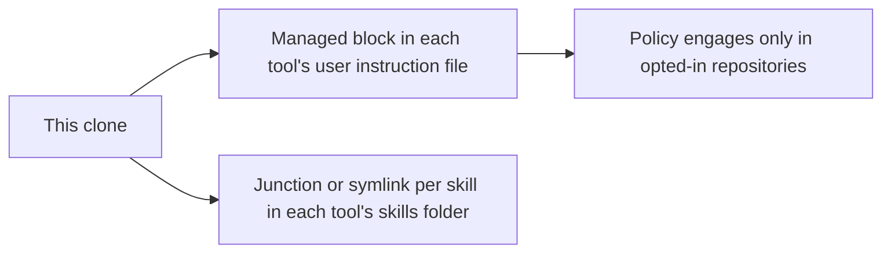

# an-dr-agents-repo-install

Installs this clone globally for local AI tools — Claude Code, Codex, Copilot CLI, DeepSeek Harness, Gemini CLI, and opencode — so every repository can use its policy and skills.

## When it runs

When you want the workflow machine-wide, or to move, update, verify, or remove a global install. Re-run it after adding a skill or moving the clone.

## How it works

- **Instruction block.** Points each tool at this clone's `AGENTS.md`. The policy engages only when a repository references it, has `.progress/workflow.json`, or you name a flow (Vibe, Spec-driven, Supervised) or a skill, so scratch folders stay free of workflow.
- **Skill links.** A junction on Windows, a symlink elsewhere; no elevation needed. `git pull` updates every tool at once.
- **Safe to repeat.** It edits only between its markers and replaces only links it recognises. A conflicting real directory stops it until you decide.
- **Verify.** `verify-agents.ps1` checks the clone, every block, and every link, and prints a table. It proves the files, not that a tool loaded them.

## What you get

Every supported tool pointed at one clone, with a verification table.

## What you decide

Which tools to configure, and what to do with a conflicting directory.

## Related skills

- [an-dr-agents-repo-verify-installation](../an-dr-agents-repo-verify-installation/README.md) — when a tool still ignores the policy.
