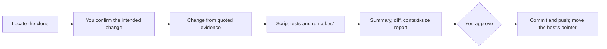

# an-dr-agents-repo-modify

The only way this workflow repository changes: it finds the clone, makes the change from evidence, runs every check, summarises it for you, and commits and pushes only after you approve.

## When it runs

For every change to this repository — `AGENTS.md`, skills, scripts — whether the need appears here or while working in another repository.

## How it works

- **Evidence first.** Each change names what the agent did, which instruction caused it, and what it should do; without evidence it is a preference and yours to decide.
- **No duplication.** Rules stated twice are cut back to one owner; the READMEs are updated with any changed behaviour.
- **Context cost visible.** A size report shows how many tokens every session now loads; growth needs a matching cut or a stated reason.
- **No side effects.** An existing rule is never weakened in passing, and the host repository's own work is left untouched.

## What you get

A summary of every changed file, the evidence behind it, what was left alone, the diff, and the size report — before anything is committed.

## What you decide

The intended change before editing, and the commit after reading the summary.

## Related skills

- [an-dr-ai-write-instruction](../../actions/an-dr-ai-write-instruction/README.md) — writes the rules.
- [an-dr-agents-repo-install](../an-dr-agents-repo-install/README.md) — refreshes installs after a change.
