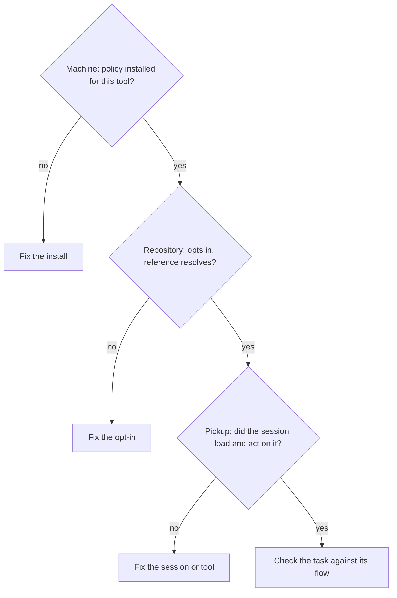

# an-dr-agents-repo-verify-installation

Diagnoses why an AI tool ignores this workflow's policy by checking three layers in order and recommending one fix for the first broken one.

## When it runs

When a tool ignores the policy, bypasses the workflow controller, or follows it while another tool does not.

## How it works

- A script checks the machine and repository layers and prints one table.
- Pickup can only be checked inside the session: can the tool state the flows and commands without reading a file, does it list the skills, did it ask the three-way flow question only when nothing was selected?
- The real task is then compared with its flow — a `vibe/` branch with no controller state for Vibe; controller state and a work branch for Spec-driven and Supervised.

The first broken layer explains the symptom; fixing a later one changes nothing. Diagnosis never starts paid agent sessions.

## What you get

The broken layer, its cause, and one command or edit to fix it.

## Related skills

- [an-dr-agents-repo-install](../an-dr-agents-repo-install/README.md) — the machine layer.
