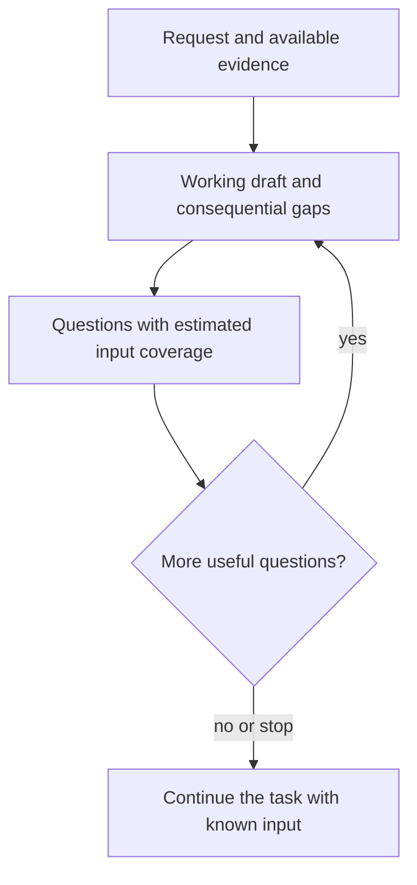

# an-dr-ai-collect-input

An optional interview that gathers the information needed for a useful, grounded result before the agent carries out a task.

## When it runs

When you ask the agent to interview you or collect input before a task, regardless of the kind of task.

## How it works

The draft is private and is not presented as a finished deliverable. The coverage estimate is a rough judgment of the information known, not a measure of task completion, and may change as gaps emerge.

## What you get

An outcome based on your answers and available evidence, with consequential assumptions and unresolved gaps identified rather than invented details.

## What you decide

Answer with a choice or your own words, skip a question, or stop the interview at any time. Stopping does not approve an action or waive a required decision.

## Related skills

- [an-dr-ai-send-message](../an-dr-ai-send-message/README.md) handles questions and answers across hosts.
- [an-dr-concept-ai-slop](../../concepts/an-dr-concept-ai-slop/README.md) describes output that costs more than it gives.
- [an-dr-concept-evidence-grounding](../../concepts/an-dr-concept-evidence-grounding/README.md) distinguishes evidence from assumption.
