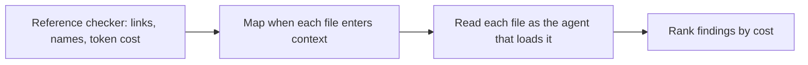

# an-dr-ai-review-instruction

Reviews the instructions an agent loads — `AGENTS.md`, `CLAUDE.md`, `SKILL.md` files, and the prompts they pull in — for contradictions, weakened rules, wasted context, and logic that belongs in a script.

## When it runs

After instructions are edited, before installing them globally, or when an agent keeps doing something the instructions did not intend.

## How it works

1. A script resolves every relative link, checks every skill name against its folder, and reports each file's size and token cost.
2. Every rule is traced to the file that carries it and the moment that file loads. A rule nothing loads at the right time does not exist.
3. The files are read in loading order, as the receiving agent sees them, stopping where two disagree.
4. Findings rank by cost: wrong behaviour first, then rules nothing can enforce, then wasted context.

It looks for three families: **contradictions** (the same fact stated two ways, prose that disagrees with a script), **weakened rules** (hedges like "try to", rules with no observable outcome, escape hatches), and **wasted context** (length in always-loaded files, facts restated instead of referenced, files no trigger reaches).

## What you get

A ranked list of findings, each naming the file, the line, and what it costs the agent.

## Related skills

- [an-dr-ai-write-instruction](../an-dr-ai-write-instruction/README.md) — writes and fixes instructions.
- [an-dr-concept-ai-slop](../../concepts/an-dr-concept-ai-slop/README.md) — the instruction-slop signals.
