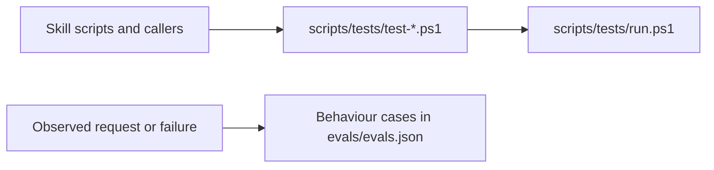

# an-dr-ai-skill-implement-test

Writes the tests for a skill: deterministic script tests that run for free, and behaviour cases that describe what an agent using the skill must do — without running any paid evaluation.

## When it runs

When you ask to add or update a skill's tests, or when a skill change needs coverage for new or corrected behaviour.

## How it works

- **Script tests** execute the real script against fixtures: results, exit codes, boundaries, failures, no-op safety. A reported defect is captured as a failing test before the fix.
- **Behaviour cases** pick decisions with observable consequences and give the agent only the evidence it needs; the expected answer stays out of the prompt. They grade artefacts and behaviour, not wording.
- Existing case IDs and regression evidence are preserved; an expectation is never changed just to make a failing case pass.

## What you get

Tests that run in `tests/run-all.ps1`, and an evaluation suite ready for someone to run when they ask.

## Related skills

- [an-dr-ai-skill-test](../an-dr-ai-skill-test/README.md) — runs them.
- [an-dr-convention-agent-skill-testing](../../conventions/an-dr-convention-agent-skill-testing/README.md) — the contract they follow.
