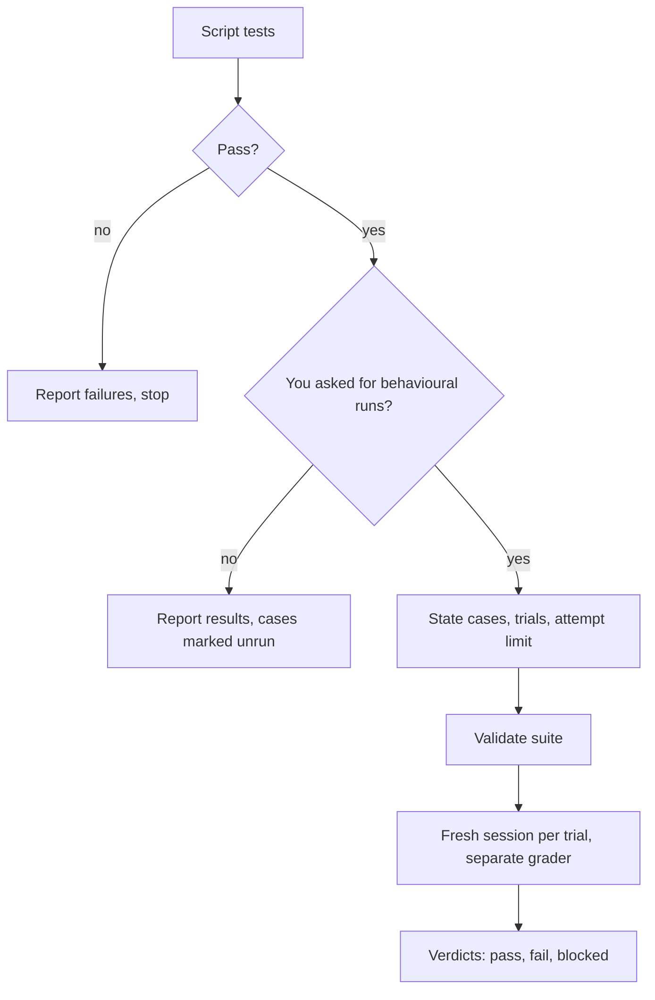

# an-dr-ai-skill-test

Runs a skill's tests: the cheap script tests every time, and paid agent evaluations only when you explicitly ask, with their cost stated up front.

## When it runs

After any change to a skill or its scripts, and whenever skill testing is requested.

## How it works

- Script tests need no approval and start no agents. Missing coverage is reported as a gap, never as a pass.
- Naming the skill, approving an edit, or routine verification never authorises a paid run; only an explicit request does.
- Before a paid run it states exactly how many attempts it will make, honours any cap, and never silently retries or compares models.
- A separate grader judges each trial, and the rubric stays hidden from the tested agent.

## What you get

Script results every time; behavioural verdicts with activation and behaviour scored separately when you asked for them.

## What you decide

Whether to run behavioural evaluations, which cases, how many trials, and any spending cap.

## Related skills

- [an-dr-ai-skill-implement-test](../an-dr-ai-skill-implement-test/README.md) — writes the tests.
- [an-dr-convention-agent-skill-testing](../../conventions/an-dr-convention-agent-skill-testing/README.md) — the contract.
