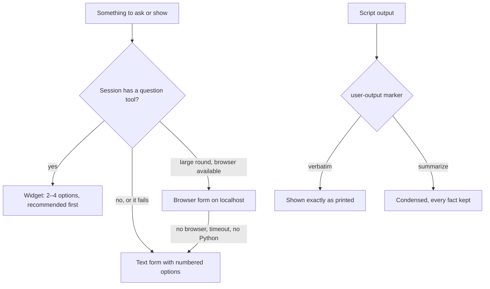

# an-dr-ai-use-user-interface

How the agent talks to you in any tool: questions through the host's own question UI when it has one, an optional local browser form for large rounds, a fixed text form when neither works, and script output relayed so you never miss a result.

## When it runs

Whenever a reply shows a table, relays script output, asks you to choose or confirm, or reads your answer — in every flow and every skill.

## How it works

- **Questions** are asked only when they block the work or the decision is yours. Up to four per round, each readable on its own, each option naming its consequence. Free text is always accepted.
- **Confirmations** are a question with exactly two options that name the action: "Delete the 3 files in `build/`?" rather than "Continue?".
- **Browser form** is an optional page on `127.0.0.1` behind a one-time token, for rounds too big for a widget. It needs Python 3 — this skill's one intentional exception to the PowerShell rule — and writes the same answers file as the text form.
- **Script output** never stays hidden in a tool result: tables, report paths, failures, and non-zero exits always reach the reply.

## What you get

Questions you can answer with one click, and every result a script produced, in Markdown that renders in any terminal or chat.

## What you decide

Every question it asks; a click and a typed reply count the same.

## Related skills

- [an-dr-concept-dark-cockpit](../../concepts/an-dr-concept-dark-cockpit/README.md) — levels for findings in replies.
- [an-dr-convention-script](../../conventions/an-dr-convention-script/README.md) — how scripts mark their output.
