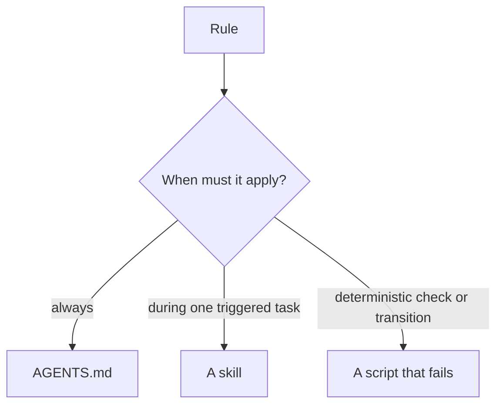

# an-dr-ai-write-instruction

Creates or changes the instructions an agent loads — `AGENTS.md`, `CLAUDE.md`, skills, prompts, and their scripts — putting each rule where it fires and wording it so its effect can be observed.

## When it runs

Whenever an agent instruction is written or amended.

## How it works

Every change starts from evidence — a request, transcript, review finding, or failed run — and states the observed and the desired behaviour. Then the rule goes to the carrier that loads at the right moment:

- One imperative, observable rule at a time; no hedges; a reason only where the rule would otherwise seem arbitrary.
- One owner per fact, linked elsewhere; detail moves out of always-loaded files whenever a later carrier can own it.
- Instructions describe the system as it works now, and an existing rule is never weakened silently.

After writing, Markdown is formatted and checked, the instructions are audited, and the changed loading path is reread as the receiving agent.

## What you get

Instructions that cost little context and change behaviour the way they claim to.

## Related skills

- [an-dr-ai-review-instruction](../an-dr-ai-review-instruction/README.md) — audits the result.
- [an-dr-convention-agent-skill](../../conventions/an-dr-convention-agent-skill/README.md) — the shape of a skill.
