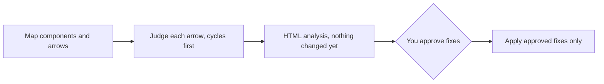

# an-dr-architecture-fix-dependencies

Untangles the dependencies of a skill, module, or package: it maps every arrow, proposes the cheapest fix for each problem in an HTML analysis, and applies only the fixes you approve.

## When it runs

When a dependency graph has cycles, a component names more than it needs, or a component should become stable.

## How it works

Each arrow lands in one bucket:

| Bucket    | Fix                                                     |
| --------- | ------------------------------------------------------- |
| Needless  | Delete it                                               |
| Misplaced | Point to the real owner, delete the restatement         |
| Reversed  | The consumer points at the stable part, not the reverse |
| Shared    | Extract the shared part into a common component         |
| Genuine   | Keep it, declared                                       |

Fixes are chosen cheapest first: delete, return a result instead of calling back, invert behind an interface, extract, merge or split, stabilise. The report records the starting counts — arrows, cycles, heavy dependents — so the improvement can be measured.

## What you get

An `untangle` HTML report with one proposed fix per problem, then a smaller, acyclic graph after the approved fixes.

## What you decide

Which proposed fixes to apply.

## Related skills

- [an-dr-concept-clean-dependencies](../../concepts/an-dr-concept-clean-dependencies/README.md) — the rules it applies.
- [an-dr-agents-repo-build-dependencies](../../_repository/an-dr-agents-repo-build-dependencies/README.md) — the skill graph diagram.
