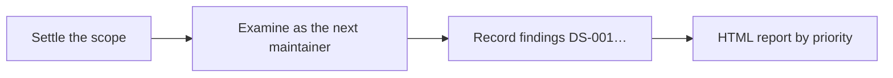

# an-dr-dev-analyze-slop

Analyses code and documentation in a defined scope for illogical design, contradictions, needless complexity, misleading prose, and AI-like artefacts, and delivers an HTML findings report with a proposed change for each.

## When it runs

When you ask to deslop something, audit coherence, or find questionable artefacts in changes, files, or a repository.

## How it works

- **Scope first.** Uncommitted work, a commit range, a branch against its base, chosen paths, or the whole repository. It never defaults to the whole repository, and a sample is never called exhaustive.
- **Only what the change introduced.** On a diff it reports problems the change added or worsened, not pre-existing debt.
- **Grounded.** Documented workflows are traced into code and tests. A convention finding quotes the rule it breaks; an unquotable rule is a preference, not a finding.
- **Every finding** has evidence with a location, its concrete cost, and a proposed change. It is either *confirmed* or a *question* naming the evidence that would settle it.

## What you get

A `deslop` HTML report with stable finding IDs and a short summary of the most consequential findings in the reply. It recommends; it does not edit.

## Related skills

- [an-dr-concept-ai-slop](../../concepts/an-dr-concept-ai-slop/README.md) — the test it applies.
- [an-dr-text-analyze-slop](../an-dr-text-analyze-slop/README.md) — the same for a single text.
