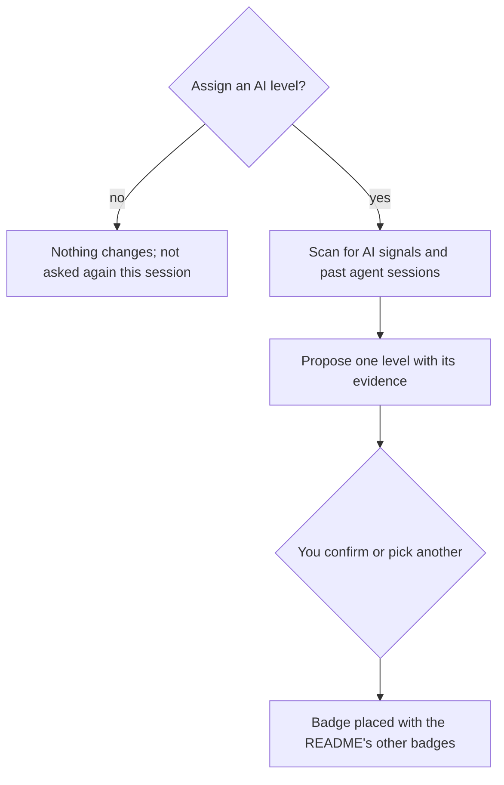

# an-dr-dev-assign-ai-level

Asks whether to disclose AI usage with an ai-level.dev badge and, if you agree, assesses the level from evidence, confirms it with you, and adds the badge to the README.

## When it runs

After a README is written or updated, or when you ask to assign, change, or check a repository's AI level.

## How it works

The level follows the highest involvement found: none (0), docs only (1), tests, configs, or assets (2), functional code with visible review (3), core logic with little review (4). Signals include commit text naming an AI tool, generated-by comments, agent instruction files, and the agent's own past work on the project. A missing signal is not proof of AI-free work, and the proposal says what could not be seen.

## What you get

The confirmed level, its evidence, and the badge at a named line in the README.

## What you decide

Whether to disclose at all, and the final level.

## Related skills

- [an-dr-convention-ai-level](../../conventions/an-dr-convention-ai-level/README.md) — what each level claims.
- [an-dr-dev-write-readme](../an-dr-dev-write-readme/README.md) — runs this after writing.
