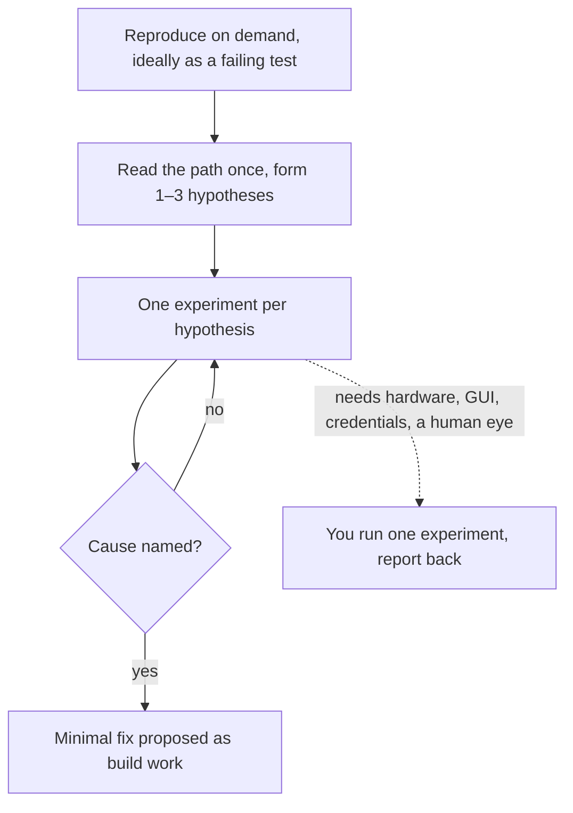

# an-dr-dev-debug

Finds the root cause of a concrete failure through experiments — reproduce, instrument, bisect — and hands you an experiment only when it needs something the agent cannot do.

## When it runs

When a bug or unexplained behaviour resists a quick reading of the code.

## How it works

Experiments include temporary logs at suspected boundaries, a probe test isolating one hypothesis, shrinking the input until the failure disappears, and `git bisect` for regressions. Reading is time-boxed: when the cause is not clear quickly, it stops reading and experiments.

The root cause is named in one sentence as a mechanism ("X is read before Y initialises it"), not a symptom. No fix lands without it, since a symptom patch is a workaround. Temporary instrumentation is removed, and nothing is committed while debugging.

## What you get

A named root cause, a reproducing test kept as the regression anchor, and the smallest fix that removes the cause.

## What you decide

Only the experiments it hands you, one at a time, with exact steps and what to report.

## Related skills

- [an-dr-dev-implement-adversarial-ut](../an-dr-dev-implement-adversarial-ut/README.md) — a broader bug hunt.
- [an-dr-dev-test](../an-dr-dev-test/README.md) — verifies the fix.
