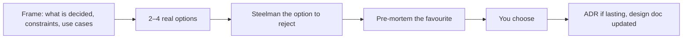

# an-dr-dev-design

Structures a design decision that is deeper than a quick pick — an options table, the strongest case for the rejected option, and a pre-mortem — so you decide with the trade-offs in front of you.

## When it runs

During a Spec-driven or Supervised DESIGN phase, or when a Vibe design question turns out deeper than expected.

## How it works

| Option | Complexity | Reversibility | Blast radius | Effort | Main risk |
| ------ | ---------- | ------------- | ------------ | ------ | --------- |

Reversibility and blast radius weigh most: a cheap, reversible choice needs little analysis, while an expensive one-way door gets the full treatment. No option exists to flatter the favourite, and an expensive one-way door with a weak pre-mortem is not presented yet.

## What you get

A decision you can see the reasoning for, an ADR when it is architectural, and a living design document at `docs/design/<topic>.md`.

## What you decide

The option. The agent never presents a single "correct" solution; in Spec-driven it does the work after DESIGN, but the design is yours.

## Related skills

- [an-dr-convention-adr](../../conventions/an-dr-convention-adr/README.md) — the decision record.
- [an-dr-dev-follow-workflow](../an-dr-dev-follow-workflow/README.md) — the DESIGN phase.
