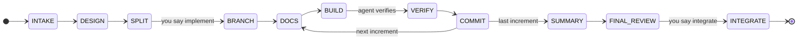
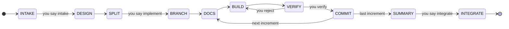

# an-dr-dev-follow-workflow

The workflow controller: it runs the two gated flows, Spec-driven and Supervised, so that phases, approvals, questions, and increments live in a file rather than in the agent's memory of the chat.

## When it runs

- You choose **Spec-driven** or **Supervised** for a task.
- A repository already holds `.progress/workflow.json`; every response then starts from the controller's status table.
- Work moves to another machine, or the plan's increments need reordering.

**Vibe** does not use it: Vibe has no phases or gates, only a branch and your land, redo, or drop.

## How it works

The controller is one script, `scripts/workflow.ps1`. Each command reads the state, checks that the transition is legal (approval present, right branch, increment committed, no open question before `implement`), writes the new state, and refuses anything else. The agent can therefore not skip a gate by forgetting it.

### Spec-driven

You shape the design; the agent does everything else and comes back with documentation, a change report, and a pull request.

- INTAKE and DESIGN are one conversation: requests, options, questions. It ends with a short design summary.
- After `implement`, the agent works unattended on `spec/<slug>`. A draft pull request opens at the first push and its CI runs on every increment.
- At FINAL_REVIEW you read the docs, the report, and the diff if you want, comment on the request, and give `integrate` when satisfied.
- On request it runs on the base branch instead: no branch, no pull request.

### Supervised

Every gate is yours, including each increment's verification.

### Questions instead of interruptions

Whatever the agent cannot settle alone becomes a recorded question. It keeps exploring and brings the questions to you together. `implement` is refused while any question is open, so nothing is built on an unanswered choice.

## What you get

- `.progress/workflow.json` — the state; committed with the work branch so another machine can resume it.
- `.progress/PROGRESS.md` — a readable snapshot of the same state.
- `tmp-agent-progress.html` at the repository root — a live page that reloads every five seconds: flow, phase strip, what waits on you, increments, questions, next steps, decisions, and recent steps. It is regenerated by every controller command, so keeping it current costs the agent nothing, and it never enters git.
- At the end, the state is deleted and removed from the delivered history.

## What you decide

| Gate        | Spec-driven               | Supervised                 |
| ----------- | ------------------------- | -------------------------- |
| `intake`    | —                         | the request list is closed |
| `implement` | the design and plan stand | the plan stands            |
| `verify`    | — (agent records it)      | each increment             |
| `integrate` | after the final review    | after the summary          |

You can also switch between the two flows before anything is built; requests, questions, and answers carry over.

## Related skills

- [an-dr-dev-integrate](../an-dr-dev-integrate/README.md) — the pull request and the merge.
- [an-dr-git-modify-history](../an-dr-git-modify-history/README.md) — every commit and its automatic push.
