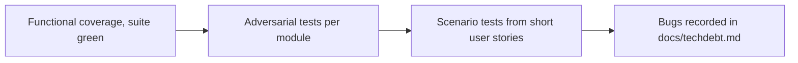

# an-dr-dev-implement-adversarial-ut

Builds a bug-finding unit test suite before anything is fixed: tests that attack assumptions rather than confirm the code works.

## When it runs

At the start of a debug or cleanup iteration, to capture the bugs that exist before fixing any of them.

## How it works

- **Adversarial tests** attack boundaries (0, -1, empty, null vs undefined), special characters used as delimiters, races between async operations, state left by a previous call, and dead paths such as settings nobody reads.
- **Scenario tests** model a realistic workflow ("user pins a symbol, then switches files"), derive what should happen from intent, and flag nonsense — settings that configure nothing, output that is thrown away.
- **Naming tells the story.** A bug found during the hunt gets a passing test named `BUG:` that asserts today's behaviour, becoming the regression anchor once fixed. A defect whose fix comes next gets a failing test asserting the intended contract.

Production code is not touched and nothing is committed; fixes are follow-up work.

## What you get

A test suite that documents every bug found, and a `docs/techdebt.md` table linking each bug to its source and test.

## Related skills

- [an-dr-dev-debug](../an-dr-dev-debug/README.md) — root-causes one failure.
- [an-dr-dev-test](../an-dr-dev-test/README.md) — verifies a change.
