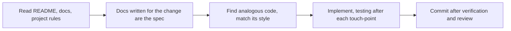

# an-dr-dev-implement-code

Writes the code: follows the repository's existing patterns and documentation, and stays inside the requested scope.

## When it runs

For any coding change, once edits are allowed.

## How it works

- **Scope.** Only the requested result. Anything else becomes a separate request.
- **Docs before behaviour.** Documentation for changed behaviour is written first. A gap is fixed before continuing.
- **Conflicts are surfaced.** Where documentation and code disagree, the agent raises it rather than picking a side.
- **Style.** The code convention applies, the host repository's own conventions override it, and new files go where the layout convention puts them.

## What you get

Working code with doc comments, compiled and tested as it was written, and an explanation of what changed, why, and what was left out.

## Related skills

- [an-dr-convention-code](../../conventions/an-dr-convention-code/README.md) — writing defaults.
- [an-dr-dev-write-documentation](../an-dr-dev-write-documentation/README.md) — the docs it builds to.
- [an-dr-dev-test](../an-dr-dev-test/README.md) — verifies it.
