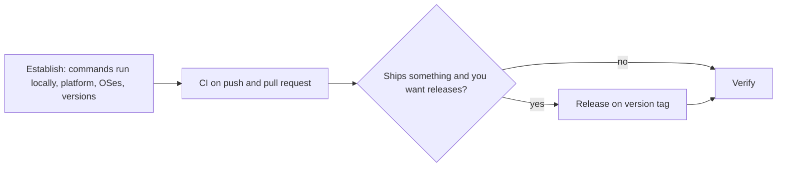

# an-dr-dev-implement-pipeline

Sets up or updates a project's continuous integration and release pipeline from what the repository actually builds and tests.

## When it runs

When a new project has no CI, when you ask for CI or a release pipeline, or when an existing pipeline no longer matches how the project is built.

## How it works

- **Grounded.** Build, lint, and test commands are confirmed by running them locally. The platform comes from the remote. Anything the repository does not show — a registry, a target — is asked, never invented.
- **CI** runs the same commands a developer runs, ideally through one entry point. Formatting and lint checks fail the build. It tests every supported OS and toolchain version and no others, pins third-party actions, and grants minimal permissions.
- **Release** triggers on a version tag, fails if the tag disagrees with the repository version, reruns the CI checks, and attaches artefacts. Credentials are platform secrets, each named for you to add.

Deploying to running environments is out of scope.

## What you get

Pipeline files whose every command was run locally, and an honest statement of whether a run on the platform happened — only that proves the pipeline.

## What you decide

The platform when there is no remote, whether to add a release, and which secrets to configure.

## Related skills

- [an-dr-convention-code](../../conventions/an-dr-convention-code/README.md) — formatter and linter setup.
