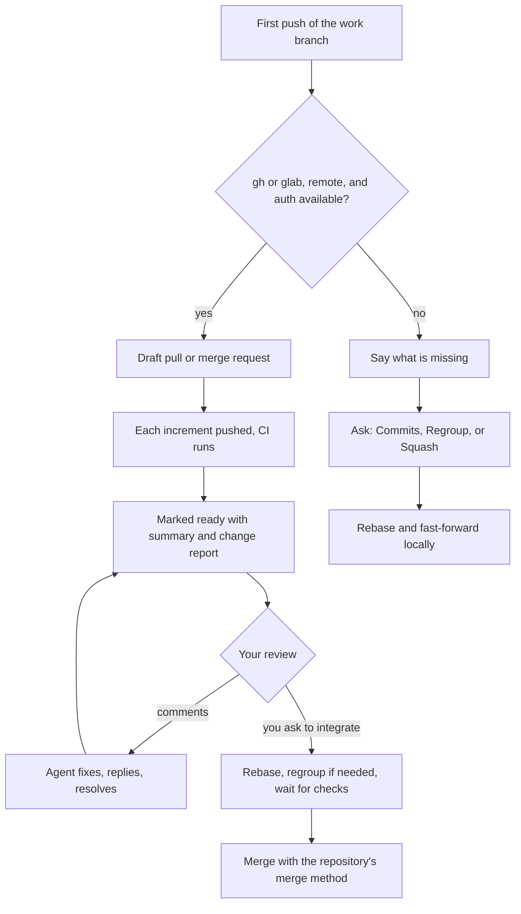

# an-dr-dev-integrate

Lands a branch on its base when you ask for it, normally through its pull or merge request, and locally only when no platform is available. The base is the branch the work started from, read from its `tmp-agent-wip.json`, so work started on `dev` lands on `dev`; without that file it is the default branch.

## When it runs

- At a branch's first push, to open a draft request.
- When you say to address the request's review comments.
- When you ask to integrate, merge, or land a branch, and only then.

## How it works

- **Review in the request.** Your comments sit on the lines they discuss. The agent answers each thread and resolves the ones it fixed. While the request is open it only adds commits, so your threads never go stale.
- **Merge method.** The request merges the way the repository is configured. GitLab applies its project setting. GitHub has no single default, so if several methods are allowed, the agent asks which one.
- **Local fallback.** Without a platform, the agent rebases and asks you each time whether to keep every commit, regroup them into a few, or squash into one. It never adds a merge commit locally.
- **Any branch, no work files.** Every file or folder whose name starts with `tmp-` or `.tmp-` — the workflow state, the progress page, generated reports — is stripped from every commit before the branch lands, and the landing is refused while one remains.

## What you get

- One pull or merge request per branch, with CI on every push and a description that links the change report.
- After the merge: the base fast-forwarded locally, the work branch deleted locally and on the remote.

## What you decide

- Whether to integrate at all: nothing lands until you ask; a green CI run or an accepted review is not permission.
- The merge method, only when GitHub allows several.
- The local mode, only on the fallback path.

## Related skills

- [an-dr-dev-follow-workflow](../an-dr-dev-follow-workflow/README.md) — hands over a branch with its state, which names the base this skill lands on.
- [an-dr-git-modify-history](../an-dr-git-modify-history/README.md) — regrouping and commit messages.
