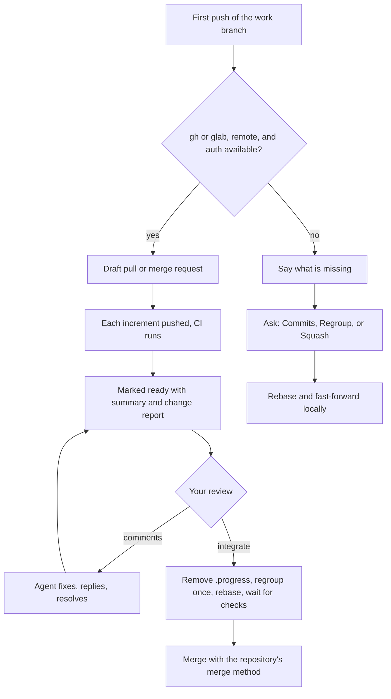

# an-dr-dev-integrate

Lands an approved work branch on the default branch, normally through its pull or merge request, and locally only when no platform is available.

## When it runs

- At a Spec-driven or Supervised branch's first push, to open a draft request.
- When you say to address the request's review comments.
- After you give `integrate`.

## How it works

- **Review in the request.** Your comments sit on the lines they discuss. The agent answers each thread and resolves the ones it fixed. While the request is open it only adds commits, so your threads never go stale.
- **Merge method.** The request merges the way the repository is configured. GitLab applies its project setting. GitHub has no single default, so if several methods are allowed, the agent asks which one.
- **Local fallback.** Without a platform, the agent rebases and asks you each time whether to keep every commit, regroup them into a few, or squash into one. It never adds a merge commit locally.
- **Clean history.** Workflow state in `.progress/` is removed from every delivered commit before anything lands.

## What you get

- One pull or merge request per workflow, with CI per increment and a description that links the change report.
- After the merge: the base fast-forwarded locally, the work branch deleted locally and on the remote.

## What you decide

- `integrate` — the merge itself; a green CI run is not permission.
- The merge method, only when GitHub allows several.
- The local mode, only on the fallback path.

## Related skills

- [an-dr-dev-follow-workflow](../an-dr-dev-follow-workflow/README.md) — when integration happens.
- [an-dr-git-modify-history](../an-dr-git-modify-history/README.md) — regrouping and commit messages.
