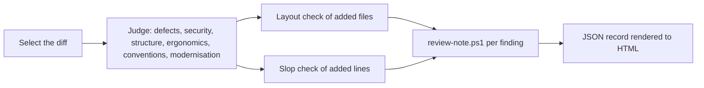

# an-dr-dev-review

Reviews a diff for defects, security issues, structure, convention violations, slop, and outdated patterns, records the findings in a JSON file, and renders them as an HTML report.

## When it runs

| Situation       | Diff reviewed                               |
| --------------- | ------------------------------------------- |
| Vibe            | the uncommitted changes for the request     |
| VERIFY          | the increment's changes, or its last commit |
| SUMMARY         | the whole work branch against its base      |
| On your request | the range or codebase you name              |

## How it works

- Every finding has a tight location and a concrete recommendation. Taste and writing preferences are not findings, and host conventions override general ones.
- Added files are placed by the layout convention; errors in paths the diff touches are findings, errors elsewhere are noted as existing debt.
- Slop in added lines — comments restating code, options nobody uses, unchecked paths — gets its own section.

## What you get

A `code-review` JSON record (the authority) and an HTML report built from it, ranked by the dark-cockpit levels. In gated flows, findings send the work back to BUILD.

## Related skills

- [an-dr-dev-test](../an-dr-dev-test/README.md) — runs beside it in VERIFY.
- [an-dr-concept-dark-cockpit](../../concepts/an-dr-concept-dark-cockpit/README.md) — finding levels.
