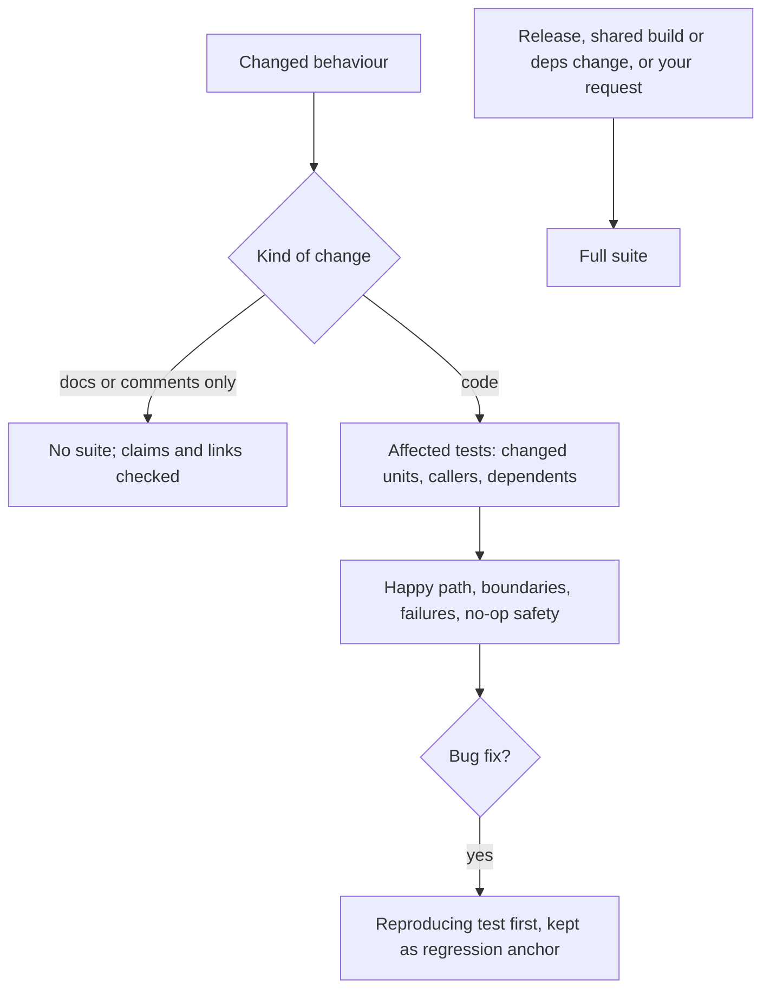

# an-dr-dev-test

Verifies a code change: picks the relevant tests, covers boundaries and failures, adds regression tests for bugs, and reports honestly what testing did and did not establish.

## When it runs

For every change to executable code.

## How it works

- The default scope is the affected tests. A check of a whole branch covers everything it touched. When CI runs the full suite on every push, the report says which tests ran locally.
- Assertions are never weakened, failing tests never skipped, and an unrelated green suite is never treated as evidence.

## What you get

Failures and gaps first, each with its level, then passing suites as one count line, then the next check or fix. Then the command you can run to see the change.

## What you decide

Whether the result is good enough; the agent reports, it does not decide for you.

## Related skills

- [an-dr-dev-review](../an-dr-dev-review/README.md) — reviews the same diff.
- [an-dr-dev-debug](../an-dr-dev-debug/README.md) — when a failure's cause is unclear.
