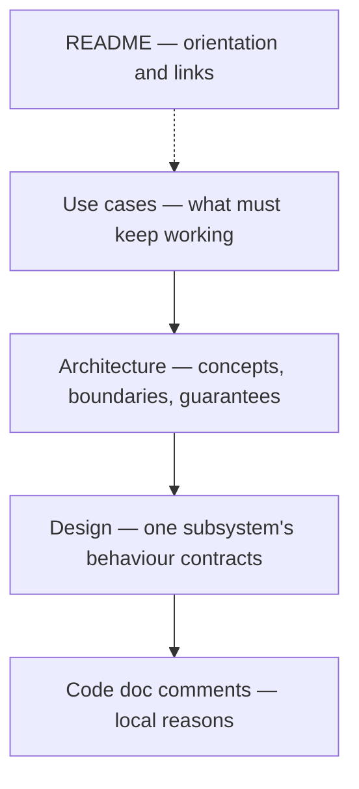

# an-dr-dev-write-documentation

Writes or updates human-facing project documentation — guides, design and architecture prose, ADRs — placing each fact in one layer and checking it against the layer above.

## When it runs

In Vibe work and in the DOCS phase of a gated flow. In Spec-driven, the docs it writes are the spec you review at the end.

## How it works

Each fact has one home:

- **Timing.** In a gated flow the increment is documented before its code exists; in Vibe the docs are updated before the behaviour changes and delivered together.
- **When.** Any change to a public interface, architecture, or observable behaviour is documented in the same delivery. An ordinary refactoring or an already-correct document is left alone.
- **How.** It describes what the system does now, in present tense and the file's established style. Every sentence passes the slop cut test. A lasting architectural decision becomes an ADR.
- **Checked.** Markdown is formatted and checked, every internal link resolves, and each layer is checked against the one above it.

## What you get

Documentation that matches the code, with one place to change each fact.

## Related skills

- [an-dr-convention-markdown](../../conventions/an-dr-convention-markdown/README.md) — the file format.
- [an-dr-dev-write-readme](../an-dr-dev-write-readme/README.md) — README rewrites.
- [an-dr-convention-use-case](../../conventions/an-dr-convention-use-case/README.md) — the top layer.
