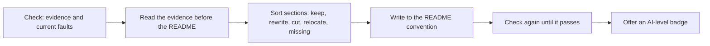

# an-dr-dev-write-readme

Rewrites or updates a repository's README from the evidence in its code, manifests, CI, tests, and docs, so every command in it works and a newcomer can trust it.

## When it runs

When a README is missing, stale, or disorganised, needs updating after a change, or should read better to a newcomer.

## How it works

- The code is ground truth; the existing README is a claim that may be false.
- Every existing section is sorted into one bucket before anything is written; content that belongs in `docs/` or an ADR is linked rather than summarised twice.
- Nothing is invented. A missing fact becomes an open question, and a command it could not run is marked unverified.
- A screenshot or GIF is added only when you ask, and always shows the project as it is now.

## What you get

A finished `README.md` (or a plan or diff first, if you prefer) with the exact command to try the project, followed by the open questions in one round.

## What you decide

The answers to the open questions, and whether to add media or an AI-level badge.

## Related skills

- [an-dr-convention-readme](../../conventions/an-dr-convention-readme/README.md) — the shape and truth rules.
- [an-dr-dev-assign-ai-level](../an-dr-dev-assign-ai-level/README.md) — runs afterwards.
- [an-dr-files-make-screenshot](../an-dr-files-make-screenshot/README.md) — README images.
