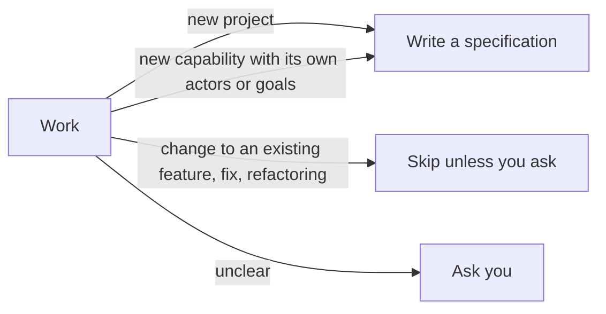

# an-dr-dev-write-specification

Writes the high-level specification of a new project or a completely new feature — its use cases and architecture — before any design detail or code.

## When it runs

It never guesses in either direction; in a gated flow an unclear case becomes a recorded question.

## How it works

1. **Context.** Reads the request, README, existing use cases, architecture, and ADRs, and notes which existing use cases a new feature could break.
2. **Use cases.** Actors named by what they do, one use case per goal, grouped by activity. Goals left out of the first delivery are listed as exclusions.
3. **Architecture**, derived from the use cases so each traces through it:

| Part                      | Content                                                 |
| ------------------------- | ------------------------------------------------------- |
| Context                   | system boundary, actors, external systems               |
| Components                | each part and its one responsibility                    |
| Boundaries and guarantees | what crosses between parts; promises such as durability |
| Decisions                 | choices expensive to reverse; lasting ones become ADRs  |

Function signatures, schemas, algorithms, and the task plan stay out — they belong to design and build.

## What you get

Use cases in `docs/use-cases/` and an architecture document, written before the code and named in the delivery.

## What you decide

Missing actors, goals, and constraints, which are always asked, never invented.

## Related skills

- [an-dr-convention-use-case](../../conventions/an-dr-convention-use-case/README.md) — use case format.
- [an-dr-dev-design](../an-dr-dev-design/README.md) — the decisions inside the architecture.
