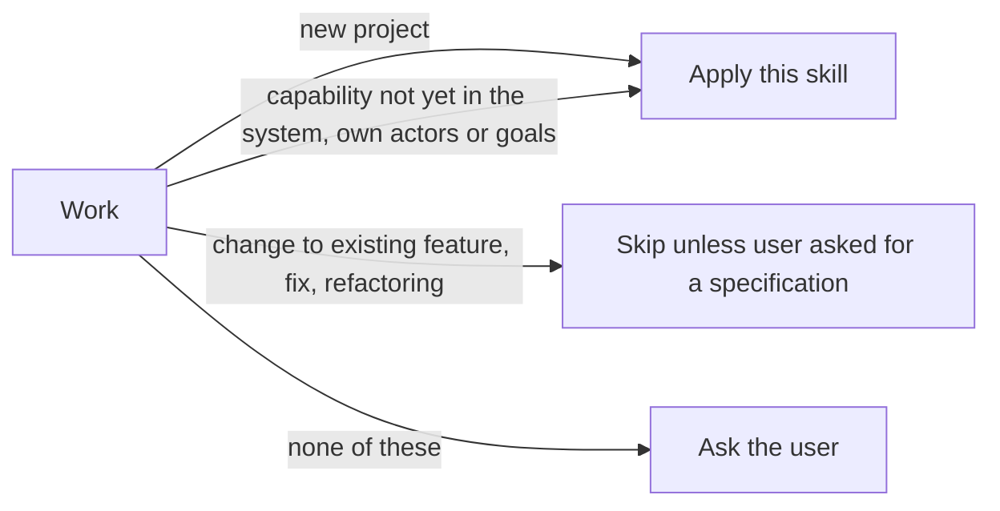

# Specification

Defers: use-case format to `an-dr-convention-use-case`; decision records to `an-dr-convention-adr`; final documents to `an-dr-dev-write-documentation`; questions to `an-dr-ai-send-message`.

## Decide whether it applies

- Ask naming the work and why it is unclear; in a gated flow, record it as a controller question first.
- Never guess in either direction.

## Establish the context

1. Read the request, `README.md`, `docs/index.md`, existing use cases, architecture documents, and ADRs.
2. For a new feature, note which existing use cases it could break and which boundaries it crosses.
3. Ask for what is missing; never invent an actor, goal, or constraint.

## Define the use cases

1. Name actors by what they do.
2. Group goals into areas by the user's activity; one use case per goal.
3. Cover what the first delivery needs; list goals left out as exclusions, not use cases.

## Define the architecture

Derive it from the use cases: each use case traces through it, each part serves at least one. State:

| Part                      | Content                                                                                            |
| ------------------------- | -------------------------------------------------------------------------------------------------- |
| Context                   | system boundary, actors, external systems relied on                                                |
| Components                | each major part and its one responsibility; dependencies follow `an-dr-concept-clean-dependencies` |
| Boundaries and guarantees | what crosses between parts, in concept; promises such as durability, offline use, security limits  |
| Decisions                 | choices expensive to reverse, with alternatives; each lasting one becomes an ADR                   |

- Draw a diagram when one short list does not make the structure obvious.
- Leave out function signatures, schemas, file formats, algorithms, and the task plan.

## Check

- Every use case passes the convention's review and maps to the components that deliver it.
- Every component and decision serves a use case or stated constraint.
- Assumptions are marked; every open choice is a question to the user.

## Output

| Part              | Location                                                                                              |
| ----------------- | ----------------------------------------------------------------------------------------------------- |
| Use cases         | `docs/use-cases/`, as `an-dr-convention-use-case` lays out                                            |
| Architecture      | `docs/architecture.md`, or the host's existing architecture document, extended rather than duplicated |
| Lasting decisions | ADRs                                                                                                  |

- Gated flow → draft in `.progress/specification.md` during read-only phases, shown before the `implement` gate; final documents written in the first DOCS phase, then the draft deleted.
- Direct → final documents written before the code and named in the delivery.

## Rules

- High level only: a statement that would change in an ordinary refactoring does not belong.
- Architecture serving no stated goal is removed, or the missing goal is raised with the user.
- Link to an existing use case or architecture section instead of restating it.
