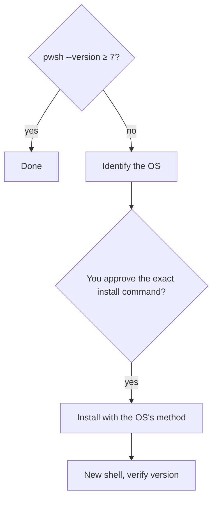

# an-dr-env-install-powershell

Installs or verifies PowerShell 7, which every script in this repository needs.

## When it runs

Before running any `.ps1` workflow or skill script on a machine where `pwsh` is missing or older than version 7.

## How it works

| OS             | Method                                                          |
| -------------- | --------------------------------------------------------------- |
| Windows client | `winget install --id Microsoft.PowerShell --source winget`      |
| macOS          | Microsoft's signed package for the machine's architecture       |
| Linux          | Microsoft's instructions for the exact distribution and version |

It uses the OS's native shell, since PowerShell may not exist yet, and never guesses a Linux package command without knowing the distribution.

## What you get

A verified PowerShell 7 in a new shell.

## What you decide

Whether to install packages or elevate; the agent names the exact command and waits for your confirmation.

## Related skills

- [an-dr-convention-script](../../conventions/an-dr-convention-script/README.md) — why PowerShell 7.
