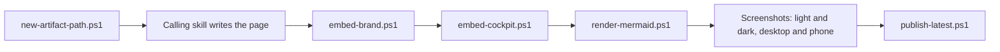

# an-dr-files-build-report

Turns a written HTML page into a finished report: takes its artefact path, embeds the brand and level styles, renders diagrams offline, checks it visually, and publishes the latest copy.

## When it runs

Whenever a skill writes an HTML report, or needs a path for any generated artefact.

## How it works

- Every exit code is checked before the next step, so a later success never hides an earlier failure.
- Diagrams render in local Chrome or Edge; a diagram that fails to parse stops the build and leaves the page unchanged.
- Nothing loads from the network, and no path is ever built by hand.

## What you get

The stamped path and the `<kind>-latest` path, with the visual check reported as complete — or blocked, and why.

## Related skills

- [an-dr-convention-html-report](../../conventions/an-dr-convention-html-report/README.md) — the page format.
- [an-dr-convention-artifact-layout](../../conventions/an-dr-convention-artifact-layout/README.md) — where it is saved.
