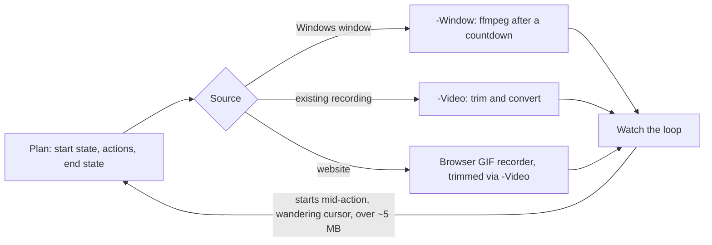

# an-dr-files-make-screengif

Records a short animated GIF of a website, application, or game in action and stores it as documentation media.

## When it runs

Only when you explicitly ask for a GIF or animation. A GIF costs megabytes in every clone and page load, so visible output gets a screenshot by default, and a GIF is offered only when a still image cannot show the point.

## How it works

- One clip, one idea, 3 to 10 seconds, starting and ending on a still frame that reads on its own.
- ffmpeg's two-pass palette keeps colours clean; a missing ffmpeg stops the script with the install command.

## What you get

`docs/media/<name>.gif`, committed with the document that shows it, reported with its duration and size.

## Related skills

- [an-dr-files-make-screenshot](../an-dr-files-make-screenshot/README.md) — the default, and the rules for storage and personal data.
