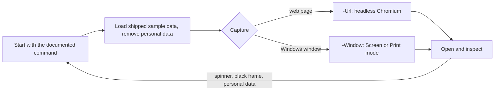

# an-dr-files-make-screenshot

Captures a screenshot of a website or a running application or game and stores it as repository documentation media.

## When it runs

When a README or document needs an image of visible output, or when you ask for a screenshot.

## How it works

- It shows realistic use, never an empty state or first-run dialog, and never an invented launch command.
- User names, home paths, tokens, and e-mail addresses are removed before capturing.
- Images stay under about 500 KB: PNG for interfaces, JPEG only for photographic game scenes.
- A page that needs a signed-in session is captured through the browser tools or by you.

## What you get

A kebab-case image in `docs/media/`, linked relatively with alt text that says what the reader sees, committed with the document that shows it.

## Related skills

- [an-dr-files-make-screengif](../an-dr-files-make-screengif/README.md) — animation, on request.
- [an-dr-dev-write-readme](../an-dr-dev-write-readme/README.md) — README images.
