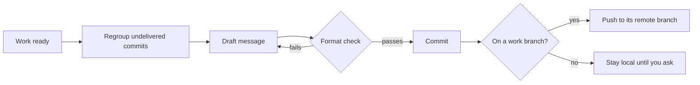

# an-dr-git-modify-history

Every commit the agent makes goes through this skill, so history reads as a list of coherent, well-described changes rather than a log of attempts.

## When it runs

- Whenever work is ready to commit, in every flow.
- Before any push or integration, to regroup commits not yet delivered.
- When existing messages on an unpushed branch break the commit format.

## How it works

- **Regroup first.** Fixes fold into the commit they fix, add-then-remove pairs disappear, small changes in one area merge, and unrelated concerns stay apart.
- **Checked messages.** A script assembles the Conventional Commits message and commits only when the format checker passes.
- **Work branches are pushed automatically.** `vibe/`, `spec/`, and `supervised/` branches are pushed after every commit, which backs up the work and lets another machine continue it. They stay rewritable, pushed with `--force-with-lease`, except while their request is under review. The base branch is never pushed from here.
- **Safe rewrites.** Rewriting messages validates every replacement first, keeps a backup ref, preserves authors and dates, and aborts if the resulting tree differs.

## What you get

Commits with a typed subject and one bullet per change in the body, grouped so each can be understood and reverted on its own.

## What you decide

Nothing routinely. You decide when the base branch is pushed.

## Related skills

- [an-dr-dev-integrate](../an-dr-dev-integrate/README.md) — landing the branch.
- [an-dr-dev-follow-workflow](../an-dr-dev-follow-workflow/README.md) — the COMMIT phase.
