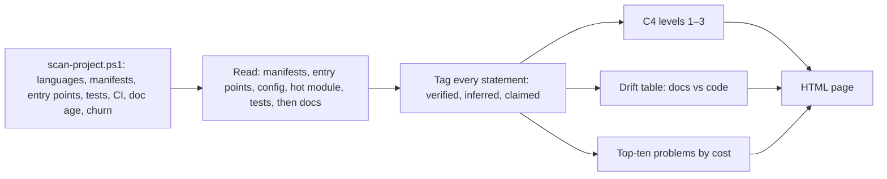

# an-dr-project-write-overview

Produces one HTML overview of an unfamiliar repository: what it is, C4 diagrams at levels 1–3 drawn from the code, a reading path, where documentation and code disagree, and the top structural problems.

## When it runs

When you arrive at a codebase, onboard someone, or want an audit of a repository's architecture and health.

## How it works

- **The code wins.** Documentation is treated as intent; every contradiction, unsupported claim, or missing component goes into the drift table.
- **Provenance is visible.** *Verified* means read in code at an existing path; *inferred* is a strong pattern; *claimed* comes only from docs and is never shown as fact.
- **Problems** are grouped by cause, ranked by practical cost, cut at ten, and each comes with the cheapest honest fix. Clean categories are stated ("No import cycles found").

## What you get

A `project-overview` HTML page in the scanned repository.

## Related skills

- [an-dr-concept-evidence-grounding](../../concepts/an-dr-concept-evidence-grounding/README.md) — the provenance rules.
- [an-dr-files-build-report](../an-dr-files-build-report/README.md) — builds the page.
