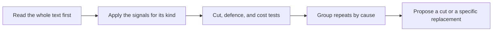

# an-dr-text-analyze-slop

Analyses a text for AI slop — restating, padding, decoration, hollow polish, unverified specifics, thin sections — and proposes what to cut or say specifically.

## When it runs

When you hand over a document, README, instruction file, report, or message and want to know what to cut or rewrite.

## How it works

| Level    | Finding                                                               |
| -------- | --------------------------------------------------------------------- |
| `high`   | slop that misleads: a claim beyond its support, an unchecked specific |
| `notice` | slop that costs time: restating, padding, decoration                  |
| `info`   | a judgement call, with why it may be intentional                      |

A replacement only states a fact the text already supports; otherwise it proposes the cut or a question for the author. It judges the text, never the author, and taste is not a finding.

## What you get

Findings `TS-001`, `TS-002`… in a table (or an HTML page past 15 findings), ending with the share of the text the proposals remove — for example `31 of 37 words, 84%`. It proposes; it rewrites only when you ask.

## What you decide

Which proposals to apply.

## Related skills

- [an-dr-concept-ai-slop](../../concepts/an-dr-concept-ai-slop/README.md) — the signals and tests.
- [an-dr-text-verify-claims](../an-dr-text-verify-claims/README.md) — checks claims against sources.
