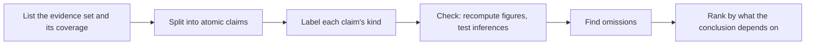

# an-dr-text-verify-claims

Audits a text against its sources: splits it into atomic claims, labels each claim's kind, and checks every one against the evidence, so you know what is backed, what is invented, and what is opinion.

## When it runs

When you hand over a report, analysis, summary, or answer together with its data and want to know how much of it holds.

## How it works

- Every number, comparison, trend, quantifier ("most", "rarely"), and causal connective ("because", "drives") is a claim.
- Derived figures are recomputed; an inference has its premises checked and the alternative explanation the data equally allows named.
- Opinions and speculation are never marked true or false — the audit states what they rest on.
- Omissions count too: left-out counter-evidence, a sample generalised to a population, a missing denominator.
- *Not found* stays separate from *contradicted*: a gap is not a falsehood. Outside knowledge appears only as a labelled note.

## What you get

A ranked audit whose headline is any contradicted or unsupported claim the conclusion rests on. It audits as written, and rewrites only on request.

## What you decide

The sources, if none were given; without them every factual claim is reported as unverifiable.

## Related skills

- [an-dr-concept-evidence-grounding](../../concepts/an-dr-concept-evidence-grounding/README.md) — the principle.
- [an-dr-text-analyze-slop](../an-dr-text-analyze-slop/README.md) — how the text reads.
