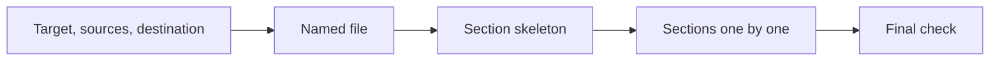

# an-dr-text-write-curated

Prepares a document in the document file itself, in gated stages: you approve the target, the sources, the file name, the section skeleton, and every section before the next step starts.

## When it runs

When you want a document built carefully, with your approval at each step, rather than written in one pass.

## How it works

- The file is created as soon as the target, sources, and destination are agreed, and every later step happens in it.
- You can edit the file or leave notes in it at any time; each step re-reads it, keeps your edits, and acts on your notes.
- Working notes (target, sources, section status) sit in a comment block at the top and are removed at delivery.
- Each section waits for approve, revise, or restructure; approved sections stay frozen.
- Final check: facts against the agreed sources, slop, coherence, and improvement options you accept or reject.

## What you get

The finished document at the destination you named or implied, or under `.tmp-ai-gen/curated-doc/` when there is none, with a list of what was verified and what rests on your word.

## What you decide

Every gate, every option, and which sources count.
