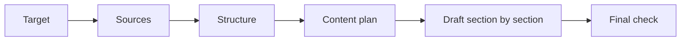

# an-dr-text-write-curated

Prepares a document in gated stages, so you approve the target, the sources, the structure, and every section before the next step starts.

## When it runs

When you want a document built carefully, with your approval at each step, rather than written in one pass.

## How it works

- Target: reader, purpose, format, destination, length, tone, exclusions.
- Sources: you agree what the document may rest on; nothing outside that set is used.
- Content plan: every claim is bound to an agreed source or to your word before drafting.
- Each drafted section waits for approve, revise, or restructure; approved sections stay frozen.
- Final check: facts against the sources, slop, coherence, and improvement options you accept or reject.

## What you get

The document at the destination you named or implied, or under `.tmp-ai-gen/curated-doc/` when there is none, with a list of what was verified and what rests on your word.

## What you decide

Every gate, every option, and which sources count.
