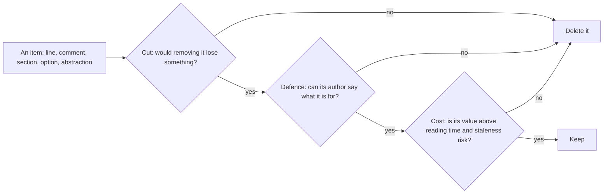

# an-dr-concept-ai-slop

Defines AI slop — output that looks finished but carries less, or costs the reader more, than its length suggests — so every skill that writes or reviews something judges it by the same test.

## When it runs

A concept is read, never run. Skills load it when they write, review, or audit a generated artifact — code, text, agent instructions, or reports — or when an item has to justify its place.

## How it works

One test decides: an item earns its place only if a reader acts, decides, or understands differently because it is there.

The concept lists how slop shows in each medium: contradictory logic and consumerless abstractions in code; restating, decoration, and unverified specifics in text; hedged or duplicated rules in instructions; conclusions that no row supports in reports. It judges the artifact, never the author, and a taste preference is not a finding.

## What you get

Shared vocabulary for findings: each names the line and the concrete cost to a reader, and slop is deleted rather than rewritten in a better voice.

## Related skills

- [an-dr-dev-analyze-slop](../../actions/an-dr-dev-analyze-slop/README.md) and [an-dr-text-analyze-slop](../../actions/an-dr-text-analyze-slop/README.md) apply it to code and to text.
- [an-dr-concept-evidence-grounding](../an-dr-concept-evidence-grounding/README.md) covers the unverified-specifics side.
