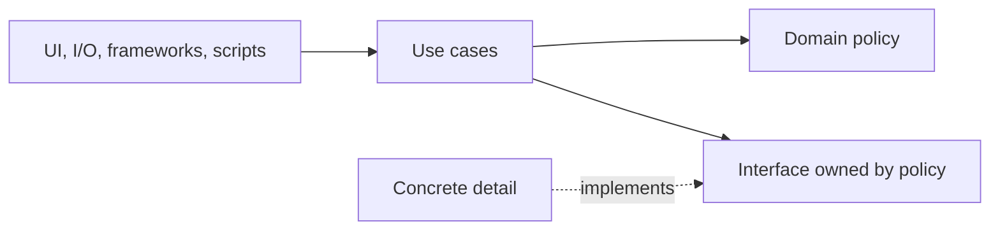

# an-dr-concept-clean-dependencies

Clean-architecture rules for how components depend on each other, applied to code and to anything else that forms a dependency graph, including these skills.

## When it runs

A concept is read, never run. Skills load it when designing or reviewing structure, adding a dependency, splitting or merging components, or judging whether a dependency belongs.

## How it works

A component is the smallest unit released and reused together: a package, module, library, or skill. Between components, dependencies form an acyclic graph that points toward stability and policy.

- **No cycles.** A cycle is broken by extracting the shared part, or by inverting one arrow behind an interface that the lower component owns.
- **Toward stability.** Depend only on what changes less often than you do; the more stable a component, the more abstract it is.
- **Through contracts.** One layer down, through its public interface, never into another component's files.
- **Coherent inside.** What changes together, and what is used together, sits together. A component serves one actor.

## What you get

A common standard for structural findings: a cycle, a stable component depending on a volatile one, a skipped layer, a reach into internals, a shared component that special-cases its consumers.

## Related skills

- [an-dr-architecture-fix-dependencies](../../actions/an-dr-architecture-fix-dependencies/README.md) — finds and fixes violations.
- [an-dr-convention-agent-skill](../../conventions/an-dr-convention-agent-skill/README.md) — applies it to skill dependencies.
