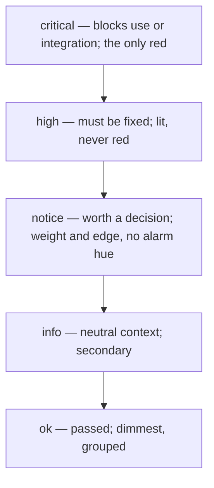

# an-dr-concept-dark-cockpit

The attention model for any output that exists to find problems: normal results stay quiet, problems light up by consequence, and red is reserved for what blocks use.

## When it runs

A concept is read, never run. Reviews, reports, test results, and checks load it to decide which level an item takes and how loud it may be.

## How it works

Every item maps to exactly one level, and loudness follows the level.

- **Normal is unlit.** No green banners or check marks; an all-clear report is one quiet line.
- **Red means critical.** Never emphasis, headings, or counts. If many items look critical, they are re-ranked.
- **Not by colour alone.** Every lit level also carries its name and a glyph, so it reads in greyscale, print, and for colour-blind readers.
- **Ordered by consequence.** Critical first; `ok` items collapse into a count.

## What you get

Reports where the eye lands on the problems first and a quiet page means nothing needs you. How each level looks in HTML belongs to the HTML report convention.

## Related skills

- [an-dr-convention-html-report](../../conventions/an-dr-convention-html-report/README.md) — renders the levels.
- [an-dr-dev-review](../../actions/an-dr-dev-review/README.md) — ranks findings with them.
