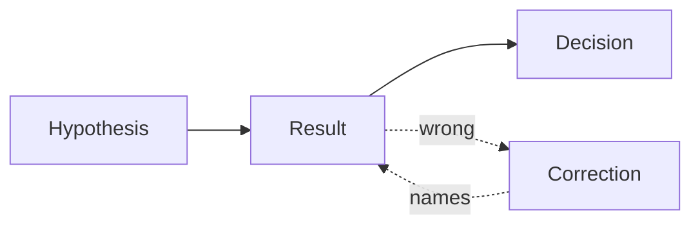

# an-dr-concept-lab-notebook

A lab notebook records why work went the way it did: what was expected before each run, what was measured, what failed, and what was decided. It is append-only and corrected, never rewritten.

## When it runs

A concept is read, never run. Skills load it when they keep or read a record of reasoning across sessions, or judge whether such a record can be trusted.

## How it works

- Entries are appended; a mistake gets a correction that names the entry it corrects.
- A hypothesis is written before the run; its result names it.
- Dead ends are recorded as carefully as successes.
- Each entry names commits, paths, and commands as evidence.
- A notebook ends with what it records.

Example in this repository: the workflow controller's `add-note` keeps a branch-scoped notebook in `tmp-agent-wip.json`, which ends with the branch at handover.

Source: Howard M. Kanare, *Writing the Laboratory Notebook* (1985), via [Lab journal](https://lispmeister.github.io/deeprecursion/posts/2026-04-15-lab-journal.html).

## What you get

A record a new session can trust: reasoning and failures survive a context reset, and results cannot be quietly fitted to the outcome.

## Related skills

- [an-dr-dev-follow-workflow](../../actions/an-dr-dev-follow-workflow/README.md) — keeps the branch notebook.
- [an-dr-concept-evidence-grounding](../an-dr-concept-evidence-grounding/README.md) — conclusions trace to evidence.
- [an-dr-concept-single-authority](../an-dr-concept-single-authority/README.md) — notebook, history, and handoff each own one thing.
