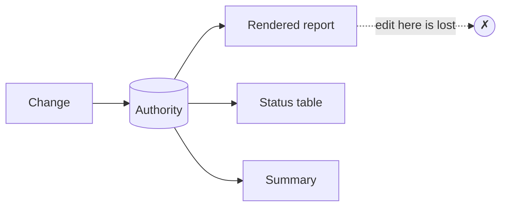

# an-dr-concept-single-authority

Every fact, decision, and piece of mutable state has one authoritative owner; every other copy derives from it or says it is a snapshot.

## When it runs

A concept is read, never run. Skills load it when state lives in several places, a rule repeats across files, a rendered output has a source, or two sources disagree.

## How it works

- Changes go to the source; derived artifacts are regenerated, never edited.
- Disagreeing sources are reported, the authority is named, and the other is fixed — never the convenient one picked.
- Conversation history does not outrank a state file, a controller result, or the code.
- A rule restated elsewhere is justified only by a point-specific detail; otherwise its owner is named.

Examples in this repository: the workflow state file owns phase and gates, and the progress page and status tables derive from it; the review JSON owns findings, and the HTML report derives from it.

## What you get

One place to change each fact, and outputs that can be rebuilt instead of hand-maintained.

## Related skills

- [an-dr-dev-follow-workflow](../../actions/an-dr-dev-follow-workflow/README.md) — state file as the authority.
- [an-dr-ai-write-instruction](../../actions/an-dr-ai-write-instruction/README.md) — one owner per rule.
