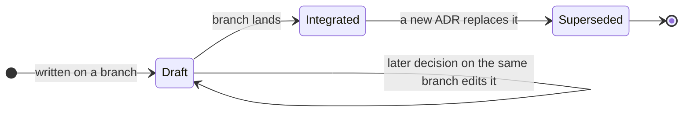

# an-dr-convention-adr

The format and lifecycle of an architecture decision record: where it lives, how it is numbered, what it contains, and when it may still change.

## When it runs

A convention is read, never run. Skills load it when writing, editing, superseding, or reviewing an ADR; `scripts/adr-new.ps1` creates one with the next number and the section skeleton.

## How it works

One ADR records one genuinely architectural decision — lasting, hard to reverse, or shaping module boundaries. Tactical and tooling choices get none. Each lives at `docs/adr/ADR-NNN-<slug>.md` with four short sections: Problem, Decision, Rationale, Rejected alternatives.

An integrated ADR is immutable, because others have read it. A changed decision is a new ADR; both link to each other in the same commit, and the old one gains only its "Superseded by" line.

## What you get

A decision history that stays readable: numbered contiguously, never silently rewritten, and committed as ordinary repository content.

## Related skills

- [an-dr-dev-design](../../actions/an-dr-dev-design/README.md) — decides when a decision deserves an ADR.
- [an-dr-convention-layout](../an-dr-convention-layout/README.md) — places `docs/adr/`.
