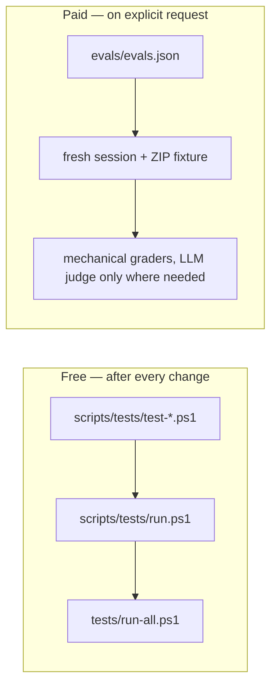

# an-dr-convention-agent-skill-testing

The contract for testing a skill: cheap deterministic script tests that run after every change, and agent evaluations that run only when someone asks and pays for them.

## When it runs

A convention is read, never run. Skills load it when authoring, executing, packaging, or reviewing a skill's tests; `scripts/check-evals.ps1` validates an evaluation suite without running any agent.

## How it works

- **Script tests** are deterministic and self-contained per skill. Each skill owns its runner; the repository runner only discovers them. A syntax check is never presented as runtime coverage.
- **Evaluations** describe realistic prompts in four buckets — explicit, implicit, noisy, and near-miss negatives — and run each trial in a fresh session against a ZIP fixture, with security checks on every case.
- **Verdicts** are pass, fail, or blocked. Activation (did the skill load?) is scored separately from behaviour (did it follow the instructions?).

## What you get

Every skill carries `evals/evals.json` and `evals/EVAL.md`, which says what must never regress and why. Script failures are reported as failures, and unrun evaluations as unrun.

## Related skills

- [an-dr-ai-skill-implement-test](../../actions/an-dr-ai-skill-implement-test/README.md) — writes the tests.
- [an-dr-ai-skill-test](../../actions/an-dr-ai-skill-test/README.md) — runs them.
