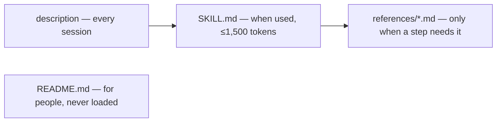

# an-dr-convention-agent-skill

The shape of a skill: the Agent Skills format plus this repository's extensions — types, layout, size budgets, reference files, dependencies, registration, and the README you are reading.

## When it runs

A convention is read, never run. Skills load it when creating, renaming, restructuring, writing, or reviewing any skill. Three scripts check it: `check-registration.ps1`, `check-skills.ps1`, and `check-skills-ref.ps1`.

## How it works

Every skill has one of three types:

| Type       | What it holds                          | The agent uses it by                     |
| ---------- | -------------------------------------- | ---------------------------------------- |
| Action     | A procedure that produces a result     | running it                               |
| Concept    | A principle and how to spot violations | reading it when its subject is in play   |
| Convention | The format of an artifact              | reading it when writing or reviewing one |

Concepts and conventions only describe; what to do with them is always an action's job.

Context is spent in layers, each fact in the cheapest layer that still reaches the agent:

A skill's reference files are private to it; other skills name the skill, never its files. Dependencies are declared in metadata and follow the clean-dependencies concept, so the graph stays acyclic.

## What you get

Skills that load cheaply and can be installed alone, each with a person-facing `README.md` (purpose, when it runs, how it works, what you get, what you decide, related skills) and a row in `skills/README.md`.

## Related skills

- [an-dr-convention-agent-skill-testing](../an-dr-convention-agent-skill-testing/README.md) — the test layout.
- [an-dr-convention-script](../an-dr-convention-script/README.md) — the scripts a skill ships.
- [an-dr-ai-write-instruction](../../actions/an-dr-ai-write-instruction/README.md) — writes skills that follow it.
