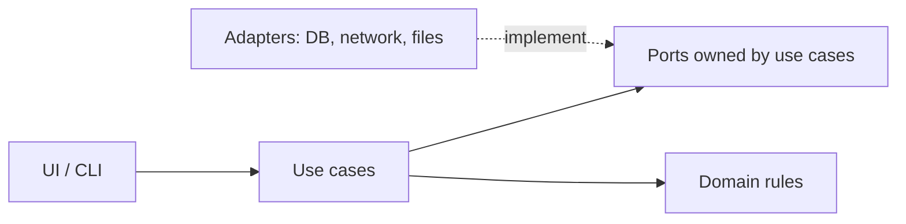

# an-dr-convention-code

Writing defaults for source code: small changes, readable names and control flow, comments for newcomers, sound error handling, clean architecture, and commits a reviewer can follow. The host repository's own conventions override every default.

## When it runs

A convention is read, never run. Code-writing and review skills load it when writing, changing, or reviewing code.

## How it works

Four groups of rules:

- **Quality.** The smallest change that solves the problem; no option, abstraction, or comment whose removal loses nothing. Failures are raised where they occur, with context. Comments describe the code as it is, never its history.
- **Names and structure.** Domain vocabulary, ecosystem conventions, pattern names only for real patterns, renames in the same change as the moved responsibility.
- **Architecture.** Dependencies point inward to domain logic. Outer services are reached through ports with adapters, wired in one composition root. Pure logic is free of I/O. A multi-event lifecycle is one explicit state.
- **Reviewable changes.** Formatting, mechanical renames, and behaviour changes are separate passes, so a reviewer sees which lines change behaviour and `git bisect` can separate causes.

## What you get

Code shaped the way an experienced developer in that language expects, and reviews that judge defects and reader cost rather than taste.

## Related skills

- [an-dr-dev-implement-code](../../actions/an-dr-dev-implement-code/README.md) — writes code with it.
- [an-dr-concept-clean-dependencies](../../concepts/an-dr-concept-clean-dependencies/README.md) — structure between components.
- [an-dr-convention-layout](../an-dr-convention-layout/README.md) — where files go.
